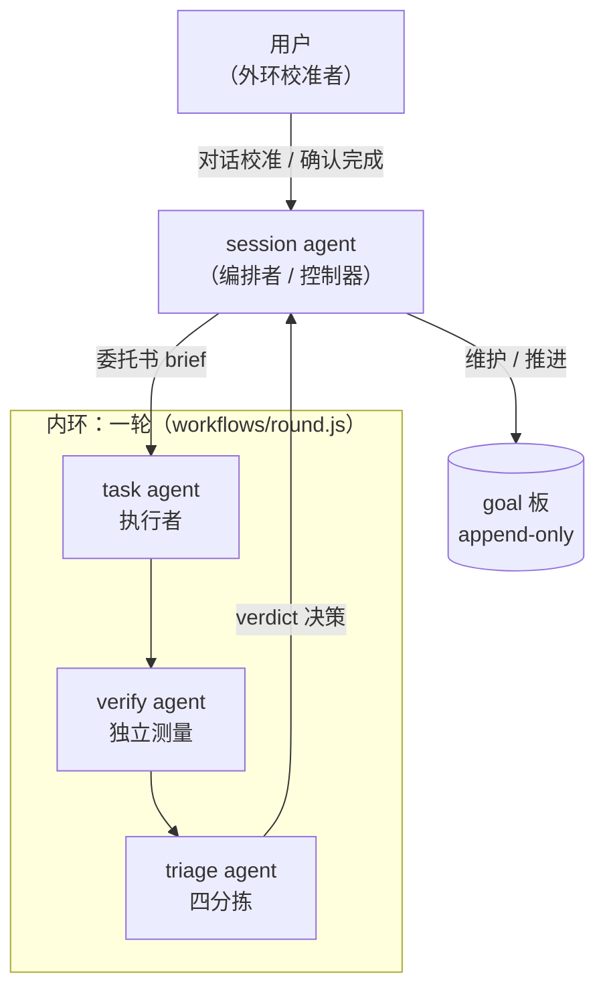

# dsh-cybernetics

  

**dsh-cybernetics 是一个把 LLM Agent 编排明确设计成控制回路的 DSH 插件**：session goal 作为 agent 的思考产物持久存在，task agent 行动、verify agent 测量、triage agent 分诊，controller 在轮间推进，用户通过对话完成外环校准——目标、行动、测量、校准的负反馈闭环。

这套协议得名于维纳的控制论：设定目标（setpoint）、行动、测量输出与目标的偏差、用偏差修正下一次行动。传统的一次性 prompt 是开环系统——目标只活在当前 prompt 里，测量的责任全在人；本项目把回路搬进系统本身，让人从「逐条 prompt 的作者」变成「目标的设定者与外环的校准者」。设计理念详见博客文章《[Cybernetics Agent——人工智能应用的新范式](https://marchliu.github.io/2026/11/03/cybernetics-agent-new-paradigm/)》。

- 协议全文：[docs/protocol.md](docs/protocol.md)
- 演进历史：[docs/CHANGELOG.md](docs/CHANGELOG.md)

## 核心概念



| 角色 | 职责 |
|---|---|
| **session agent** | 编排者（控制器）：识别用户输入、维护 goal 板、启动/收取/取消轮、向用户转述；从不亲自执行任务 |
| **controller** | `src/controller.ts` 的轮间状态机：`startRound`/`foldRound`/`runRound`，按轮推进 subgoal（task → verify → triage），维护审计日志 |
| **task agent** | 执行器：无对话历史的独立 sub agent，面向工作委托书（brief）实际执行，产出结构化交付报告 |
| **verify agent** | 测量仪器：独立于执行者验收，产出结构化 verdict `{met, criteria, gaps, goalItselfQuestionable}` |
| **triage agent** | 分诊：对 verdict 暴露的后续线索四分拣 auto / defer / reject / human |
| **用户** | 外环校准者：对话校准（goal 修订经 session agent 的 `revise` 执行）、裁定 human 类目、确认完成——controller 永不自宣完成 |

**goal** 是一等公民的持久状态（objective + 当前 subgoal + 完整工作委托书），构建在 dsh-goal 服务之上，v0.2 起不再依赖 goal.md 文件。内环（task → verify → triage → subgoal 修正）在目标不变时自动迭代，每轮有连续迭代上限兜底；外环（用户 ↔ session agent）只在目标本身有问题时介入——verdict 的 `goalItselfQuestionable=true` 会禁止自动迭代、强制回对话。

## 功能特性

### 全量 goal 模式（`allGoalsMode`，默认 false）

开启后注入「ALL-GOALS MODE ACTIVE」路由协议：**任何用户请求一律先建 goal 再执行**，session agent 禁止用读工具就地完成任务——哪怕单文件查询或一次计算也走回路。简单只读请求 → `quick` 单轮；复杂分析/写任务 → `full` 多轮渐进（`start` 异步启动 + 逐轮 `collect` 收敛）。关闭模式时提示段与 revise 行为与 v0.6 完全一致。

### 硬门（`hardGate`，默认 false）

装配期从顶层 session agent 的工具清单中**物理移除**执行工具（默认 bash/edit/write，可用 `gatedTools` 覆盖）——模型看不见这些工具，自然无法调用，编排从劝告变成结构。`gateMode: 'allowlist'` 反转语义：顶层 agent 只保留读 + 对话 + 展示 + goal/编排动词（内置 DEFAULT_GATE_ALLOWLIST，可 `gateAllowlist`/`gateAllowlistExtra` 覆盖），针对变更类工具的长尾（farm_*/taskboard_*/schedule_*……）。task/verify/triage 子 agent 从不在门禁范围内，保留全部工具。

### append-only goals 与 revise 决策树

goal 一经存在不再原地修改。`revise` 是唯一的改目标动词（必填 `reason`）：创建带 `parentGoalId` 的新 goal 并立即启动其第 1 轮，旧 goal 置 `superseded` + 记录 `supersededBy`；每次修订追加审计行到 `.cybernetics/revisions-<新goalId>.jsonl`。v0.7 起 `abortPrevious` 缺省时按自动决策树裁定（纯函数 `decideAbort`，依据 goal 板 running 状态）：

- (a) 旧轮在跑且修订改写目标本身（objective/depth 变化）→ **自动中止旧轮**；
- (b) 旧轮在跑但目标不变（仅 brief/title/role 修正）→ **等待旧轮自然结束**；
- (c) 旧 task agent 已结束 → **直接启动新 goal**。

显式传 `abortPrevious: true/false` 保持人工控制；每次修订的审计行与 `revise` 返回值都携带 `abort: {abort, mode: auto|explicit, basis}`。

### quick / full 双档轮次（depth）

- `quick`：单 task agent 一轮出结果直接反馈，跳过 verify/triage，成本约 1/3，verdict 由任务报告派生；
- `full`（默认）：完整 工作 → 验证 → 分诊 循环，验收通过才交付。协议明令禁止用 quick 抄近路做变更。

### 持久执行者（persistent executor）

`executor: 'ephemeral' | 'persistent'`，与 depth 正交。persistent 用 Agent Teams 的持久 teammate 执行 task 工作：首轮 `spawnTeammate(context:'fresh')` 投生，后续轮只投递**委托书修订**（新增约束/验收标准变化/范围收窄，禁止开放式对话）；full 轮中 teammate 报告直接作为 task 报告，verify/triage 仍以临时 agent 独立运行——验证不继承任务叙述。软集成 Agent Teams（无注入反射 + 异常安全探测），取不到即回退 ephemeral。goal 板持久化到 `<workspace>/.cybernetics/board-<sessionId>.json`，宿主重启后自动 rehydrate，「目标」页签不清空。

### 多 goal 板与「目标 / 控制」客户端页签

同一 session 支持多个并发 goal（插件自有 goal 板；dsh-goal 的单槽降级为焦点 goal）。客户端 `lib/client.js` 提供两个会话页签，经插件自有 session 投影 `cyberneticsGoals` 实时推送、就地更新：

- **「目标 / Goal」**：本会话全部 goal（标题 / 状态徽标 / 第 N 轮 / 当前 subgoal / depth、executor 小标签 / 被取代与修订来源标注），按「未完成在前、已完成在后」两段排序；空板回退 dsh-goal 单 goal 渲染。
- **「控制 / Control」**：递归展示本会话全部 agent（主控 + subagent catalog）的运行状态与各自 goal 视图，顶部汇总运行中数量，并列出每个 goal 的执行者行（状态 + 标题 + executor 临时/持久 + 持久 teammate 名称 + 轮次），与「目标」页签同一数据源。

### 插件页配置卡片

`src/index.ts` 导出 schemastery `Config` schema，宿主据此派生 Web 编辑器「插件」页的本插件设置卡片；`lib/client.js` 注册 `plugins.item` / `plugins.bundle.config` / `plugins.row.config` 三个席位（bundle 详情页与组件详情页都能配置）。volatile 字段保存即时生效（loader 直接提交进运行实例，不 remount）；非 volatile 字段保存触发插件行 remount（需宿主重载）。写入落点是用户 patch 行（profile `cordis.patch.yml` 的 `{id, name, config}` 行）。

### agent 模型选择

- **扁平字段**：`taskAgentModel` / `verifyAgentModel`（「provider/model」或裸模型名，volatile）；**留空 = 与 session agent 一致**（fallback 语义）。保存后下一轮 goal 即生效，无需重载。
- **roles 表**：按角色覆盖 sub agent 模型（`default`/`verify`/`triage` 固定槽位 + 任意命名任务角色）：

```yaml
- id: dsh-cybernetics
  config:
    roles:
      default: { provider: zai-coding-cn, model: glm-5.3 }
      verify:  { provider: zai-coding-cn, model: glm-5.3 }
      writer:  { provider: zai-coding-cn, model: glm-5-turbo }
```

## 安装与使用

### 安装

npm 包名 [`@mars.liu/dsh-cybernetics`](https://www.npmjs.com/package/@mars.liu/dsh-cybernetics)。在 DSH profile 中以 `link:` 方式安装本目录即可——插件对宿主包零运行时依赖（工具注册用裸 JSON Schema + 内联校验），不需要自己的 node_modules；要求 Node >= 23.6。

从源码安装：

```bash
git clone https://github.com/MarchLiu/dsh-cybernetics.git
cd dsh-cybernetics
```

在你的 DSH profile（如 `~/.dsh/profiles/web/`）中 link 安装：

```bash
# profile/package.json 的 dependencies 添加：
#   "dsh-cybernetics": "link:/path/to/dsh-cybernetics"
# 然后在 profile 目录执行：
pnpm install
```

安装后：

- 服务端：`src/index.ts`（`cybernetics` 工具 + 隐式触发提示段）+ `src/controller.ts`（轮间状态机）+ `src/executor.ts`（执行者适配层）；
- 客户端：`lib/client.js`（「目标 / 控制」页签 + 插件页配置卡片），**改动后需重启宿主**（客户端模块图在宿主启动时构建）并刷新浏览器；`src/` 改动需宿主重载；`workflows/round.js` 改动热生效。

### 插件页配置

Web 编辑器「插件」页的本插件卡片上直接配置（字段说明见 `Config` schema 的 description）：

- **全目标模式**（`allGoalsMode`，volatile）：切换保存即时生效，提示段即时重挂；
- **task/verify agent 模型**（volatile）：留空继承 session agent；
- **硬门相关**（`hardGate`/`gateMode`/`gatedTools`/`gateAllowlist`/`gateAllowlistExtra`，非 volatile）：保存触发插件重载。

> **已知宿主缺陷**：在部分运行时上，卡片切换保存会被宿主**静默拒绝**（写不落盘、RPC 错误不上控制台）。经取证，拒绝发生在宿主 `ConfigEditor.edit` 落盘之前的预写闸门——运行中宿主装配的插件 schema 若早于 volatile 标注，宿主即以「Config field "…" is not volatile」在写前拒绝（见上游 Discussion [#12045](https://github.com/deepseek-ai/dsh/discussions/12045)）。**workaround**：重启宿主装配最新 schema + 强刷浏览器；或手工在 profile `cordis.patch.yml` 添加用户 patch 行（如 `- id: dsh-cybernetics` + `config: { allGoalsMode: true }`）后重启。v0.7.6 起卡片本身不再吞错：仍被拒时会显示宿主拒绝原文并回弹开关。详见 [docs/CHANGELOG.md](docs/CHANGELOG.md) v0.7.4–v0.7.8 各条。

### 会话内使用：`cybernetics` 工具

session agent 在会话内通过 `cybernetics` 工具（`toolName` 可配置）驱动回路，隐式触发提示段（`implicitTrigger: false` 可关）会指导它不等显式要求就按输入分类协议调用：

| action | 语义 |
|---|---|
| `start` | 新任务：`{action:'start', title, brief}` 建 goal 并（默认后台）启动第 1 轮 |
| `round` | 阻塞式驱动一轮（对既有 goal 或新建 goal） |
| `collect` | 折叠已完成的后台轮，得到 controller 决策（continue/pause） |
| `revise` | 修订目标：创建新 goal（append-only），`reason` 必填，可选 objective/title/depth/executor/abortPrevious |
| `cancel` | 中止在跑的轮（不改目标；只中止不改目标时用） |
| `list` | 查看本会话 goal 板全部 goal 的状态、轮次与运行句柄 |

配套审计：每轮结构化结果落 `.cybernetics/round-<goalId>-<N>.json`；修订落 `.cybernetics/revisions-<新goalId>.jsonl`；goal 板快照落 `.cybernetics/board-<sessionId>.json`。

## 设计动机与原理

（提炼自博客文章，完整叙事见原文；协议细节见 [docs/protocol.md](docs/protocol.md)。）

- **为什么「goal 是 agent 的思考产物」**：传统范式里人是控制器、模型是执行器，回路只存在于人的脑子里。让 session agent 自己把用户输入整理为持久 goal（用户通过对话校准 agent，agent 修订 goal），目标才成为系统里可跟踪的一等公民状态——反馈回路的第一块积木。
- **为什么 append-only**：目标被悄悄改写，会摧毁「经 goal 跟踪 agent」的全部价值——页签上的目标不再是你当初设定的目标。身份与历史由 goal 链表达，正如 git 用不可变 commit 表达历史；每次修订的 reason + 审计行就是校准的显式变更记录。
- **为什么 verify 独立于 task**：验证者若看执行者的叙述，会退化成「检查自述是否自洽」而非「检查事实是否满足目标」。测量仪器必须独立于被测对象——协议的核心不变量：**上下文是被配给的，不是被继承的**（task 只拿委托书、verify 只拿 goal + 报告 + 证据、triage 只拿 verdict，永不用 `context: 'fork'`）。持久的是身份和 goal 边界，不是会话历史。
- **为什么硬门**：早期的「session agent 不亲自执行」只是提示里的劝告，模型看到琐碎任务就会内联干完。硬门在装配期物理移除执行工具，把劝告变成结构——编排者的全部产出是 goal 和 brief（信息），执行者的全部产出是对世界的改变（行动），可观测性与可控性的边界划在角色上，不依赖模型自觉。
- **振荡防御与升级路径**：每轮连续迭代上限是对「反馈延迟过大导致振荡」的工程化防御；triage 的 human 分拣是控制器为「不可自动处理的扰动」预留的升级路径；`goalItselfQuestionable` 在结构上区分「方向错了」和「执行得不好」。

## 与 DSH 现有机制的关系

- **goal**：不替代——dsh-goal 仍是 durable setpoint 与续跑驱动；本插件是它的工作回路。
- **workflow**：每轮就是一次 `ctx.workflowEngine.start()` run；不新增编排机制（构建在 `dsh-workflow` 之上）。
- **完成确认**：controller 永不自宣完成、不代改 goal phase；`met` 也只暂停等用户。

## 已知限制

1. **settings 写入的宿主缺陷**：如「插件页配置」一节所述，该运行时上卡片保存可能被宿主在落盘前拒绝（上游 [#12045](https://github.com/deepseek-ai/dsh/discussions/12045)）；workaround：重启宿主 + 强刷浏览器，或手工 patch 行 + 重启。
2. **volatile 与非 volatile 字段的保存语义差异**：volatile 字段（`allGoalsMode`、`taskAgentModel`、`verifyAgentModel`）保存即时生效、不 remount；非 volatile 字段（`hardGate`、`gateMode`、`gatedTools`、`gateAllowlist*`、`roles`、`toolName`、`implicitTrigger`）保存触发插件行 remount，需宿主重载完成。且宿主设置表单只服务也只接受 volatile 路径——运行中宿主的 schema 过旧时，volatile 写也会被拒（重启即愈）。
3. **`link:` 安装注意事项**：客户端 bundle 的注册 id 必须等于 package.json 的 `name`（`@mars.liu/dsh-cybernetics`）；loader 行 id 可用短名 `dsh-cybernetics`。插件需挂在本 profile 的**顶层** loader entries（客户端扫描只枚举顶层行）；`src/` 改动需宿主重载、`lib/` 改动需重启宿主 + 刷新浏览器。
4. 其他协议边界（硬门在装配层不在执行层、dsh-goal 焦点槽不随 superseded 迁移等）见 [docs/protocol.md](docs/protocol.md) 各「已知边界」小节。

## 演进历史

| 版本 | 关键节点 |
|---|---|
| v0.2 | session-goal 模式 + 隐式触发 + 角色化 sub agent + 客户端 goal 页签 |
| v0.3 | 多 goal 板 + 编排者协议 + 异步轮（start/collect/cancel/list）+ 委托书 brief |
| v0.4 / v0.4.1 | 硬门；allowlist 门模式（封住变更工具长尾） |
| v0.5 | 双档轮次 depth（quick / full） |
| v0.6 | append-only goals、持久执行者、多 goal 投影、板持久化与 rehydrate、控制页签执行者行 |
| v0.7–v0.7.8 | 全量 goal 模式 + revise 自动决策树；插件页配置卡片；volatile 模型字段；写入落点取证与保存失败可见化（离线测试 56 项） |

完整逐版记录与 dogfooding 实测修正（含 2026-11-02 启动链路四次修正、页签渲染两连修等）见 [docs/CHANGELOG.md](docs/CHANGELOG.md)。

## 许可

MIT License，Copyright (c) 2026 MarchLiu。完整许可文本见 [LICENSE](LICENSE)。
