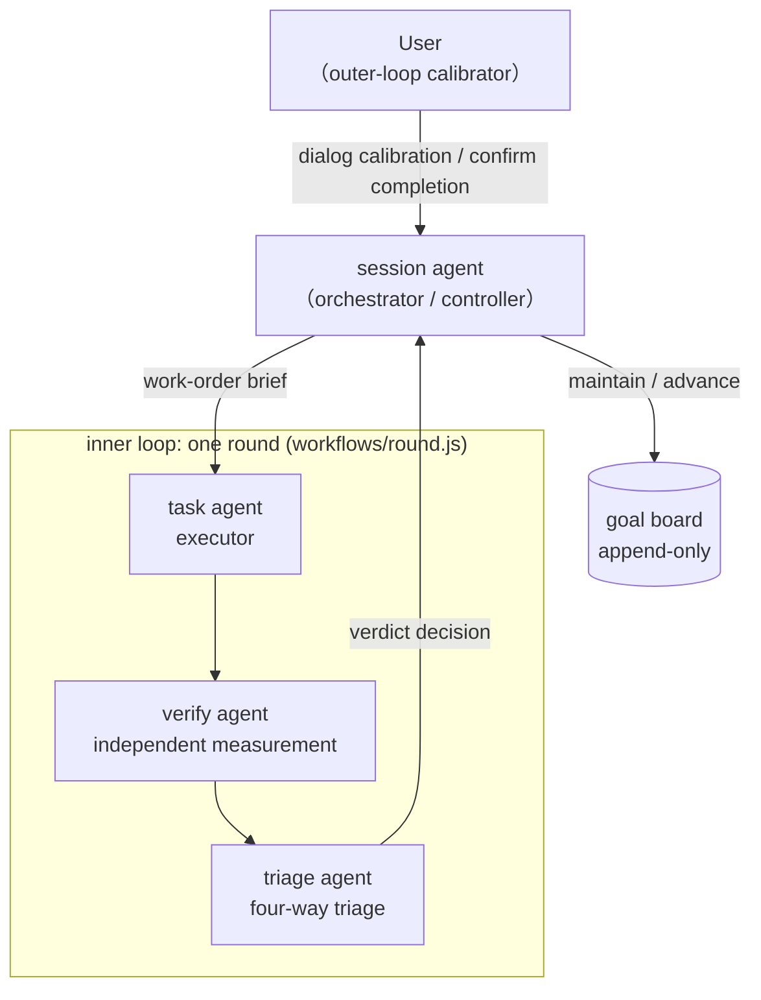

# dsh-cybernetics

[English](README.md) | [简体中文](README.zh-CN.md)

  

**dsh-cybernetics is a DSH plugin that explicitly designs LLM agent orchestration as a control loop**: the session goal persists as an artifact of the agent's thinking; the task agent acts, the verify agent measures, the triage agent triages, the controller advances between rounds, and the user calibrates the outer loop through conversation — a negative-feedback loop of goal, action, measurement, and calibration.

The protocol takes its name from Wiener's cybernetics: set a goal (setpoint), act, measure the deviation of the output from the goal, and use that deviation to correct the next action. A traditional one-shot prompt is an open-loop system — the goal lives only inside the current prompt, and the burden of measurement falls entirely on the human; this project moves the loop into the system itself, transforming the human from "the author of prompts, one by one" into "the setter of goals and the calibrator of the outer loop." The design rationale is described in the blog post "[Cybernetics Agent — A New Paradigm for AI Applications](https://marchliu.github.io/2026/11/03/cybernetics-agent-new-paradigm)" (in Chinese).

- Full protocol: [docs/protocol.md](docs/protocol.md) (Chinese)
- Evolution history: [docs/CHANGELOG.md](docs/CHANGELOG.md) (Chinese)

## Core Concepts



| Role | Responsibility |
|---|---|
| **session agent** | Orchestrator (controller): recognizes user input, maintains the goal board, starts/collects/cancels rounds, relays results to the user; never executes tasks itself |
| **controller** | The inter-round state machine in `src/controller.ts`: `startRound`/`foldRound`/`runRound`, advancing the subgoal round by round (task → verify → triage), maintaining the audit log |
| **task agent** | Executor: an independent sub agent with no conversation history, actually executing against the work-order brief, producing a structured delivery report |
| **verify agent** | Measuring instrument: accepts/rejects independently of the executor, producing a structured verdict `{met, criteria, gaps, goalItselfQuestionable}` |
| **triage agent** | Triage: sorts the follow-up leads exposed by the verdict into four categories — auto / defer / reject / human |
| **User** | Outer-loop calibrator: calibrates through conversation (goal revisions go through the session agent's `revise`), adjudicates human-class items, confirms completion — the controller never declares completion by itself |

**goal** is a first-class, persistent state (objective + current subgoal + full work-order brief), built on top of the dsh-goal service; since v0.2 it no longer depends on a goal.md file. The inner loop (task → verify → triage → subgoal correction) iterates automatically while the goal is unchanged, with a per-round cap on consecutive iterations as a backstop; the outer loop (user ↔ session agent) intervenes only when the goal itself is in question — a verdict with `goalItselfQuestionable=true` forbids automatic iteration and forces a return to conversation.

## Features

### All-goals mode (`allGoalsMode`, default false)

When enabled, injects the "ALL-GOALS MODE ACTIVE" routing protocol: **every user request first creates a goal, then executes**; the session agent is forbidden from completing tasks in place with read tools — even a single-file lookup or one calculation goes through the loop. Simple read-only requests → a single `quick` round; complex analysis / write tasks → progressive multi-round `full` (async `start` + round-by-round `collect` convergence). When the mode is off, the prompt segments and revise behavior are exactly the same as v0.6.

### Hard gate (`hardGate`, default true — active out of the box; v0.8.10: toggleable on the settings card)

**Hot toggle (v0.8.10).** `hardGate` is a **volatile** field: the plugins-page settings card renders a live switch for it. Saving the toggle commits into the running instance and the plugin disposes or (re)installs the gate listeners (assembly strip + dispatch deny + approval relay) immediately — no restart, no plugin reload. A hot false→true re-derives the mode from the current `gateMode` resolution (explicit config wins; otherwise the structural allowlist). The other gate fields (`gateMode`/`gatedTools`/`gateAllowlist`/`gateAllowlistExtra`/`gateApprovalRelay`) remain non-volatile config-document fields; edit those in the profile config document (saving triggers a plugin reload). Deployment nuance: the first time this build ships, the running host still holds the pre-0.8.10 code — restart the host once to load it; after that the toggle is hot (`lib/client.js` needs only a browser refresh).

**Effective mode (v0.8.6, default-safe).** When `hardGate` is on and `gateMode` is not configured, the gate runs in **`allowlist`** mode: the top-level session agent keeps only read + conversation + presentation + goal/orchestration verbs (the built-in `DEFAULT_GATE_ALLOWLIST`, extendable via `gateAllowlist` / `gateAllowlistExtra`), and every change-class tool is removed at assembly **and denied at dispatch**. This is the default stance because the old `denylist` default was a trap: it hid only the three names in `gatedTools` (bash/edit/write) and left `bsk_*`, `taskboard_*`, `schedule_*`, `farm_*`, `uno_*`, `ppt_*`, `config_restore` and the rest of the mutation long tail callable — a hard gate in name only. `hardGate: false` installs no gate, exactly as before. An explicitly configured `gateMode` is honored verbatim; the schema has **no default** for `gateMode`, so "unset" stays distinguishable from "explicitly denylist".

**Explicit `gateMode: 'denylist'` (residual risk, opt-in).** Only the names in `gatedTools` (default bash/edit/write) are removed. On a top-level agent the following remain available, at least: `bsk_*` (browser automation, including `bsk_session` start/stop), `taskboard_*` writes (create/update/move/comment/checklist/delete), `schedule_*` writes, `farm_*` service lifecycle (start/restart/stop/register/unregister), `uno_*` and `ppt_*` generators, `config_restore`, `subagent`/team spawning, `knowledge_save`, `job_kill` — anything not listed in `gatedTools`, and the set grows with every installed plugin, so a denylist can never be complete. Choose it only if you consciously accept that risk (e.g. the session agent legitimately manages services), and list every mutation tool you need in `gatedTools`. In this mode the injected HARD GATE guidance states the partial stance explicitly (only `gatedTools` removed) and no longer claims that all change tools are structurally unavailable.

The task/verify/triage sub agents are never subject to the gate and keep all tools.

### Sub-agent approval relay (`gateApprovalRelay`, default true)

The host pins every delegated child (workflow subagent, teammate) to the `never` approval policy at delegation — each ask is deterministically rejected **before any answerer sees it**, so a task agent that needs a sandbox escalation (typically writing outside the session workspace, e.g. `~/.dsh/profiles/web/cordis.patch.yml`) fails without the user ever being asked. With `gateApprovalRelay` on (default, hardGate companion), the plugin:

1. **Unpins the child policy at creation** — on `agent/created` for any delegated child it appends one durable `approval/policy {policy:'ask'}` event to the child session (a later event wins over the delegation-seeded pin, per the host's own fold rule). Without this the approval service short-circuits every ask to `rejected` before any answerer runs.
2. **Re-issues the ask on the top-level session agent** — the plugin registers its `approval/request` answerer **outermost** (`prepend: true`). That is the fix for the last hop: the host's `api-remotes` registers an `approval/request` forwarder at boot, before every user plugin, and the browser's approval answerer claims a child request and awaits a per-session panel that is invisible while the user watches the parent conversation, never calling `next()` — so a relay registered later can never run at all. Running first, the relay resolves the child's **top-level live ancestor** (via the durable `parentSession` chain) and calls the host's own `ApprovalService.request` on it: the request surfaces as the native **Allow once / Reject** panel in the conversation the user is already watching, and is audited as `approval/asked` + `approval/decided` on that session. The child's tool-call id is deliberately not forwarded, and the panel headline names the sub-agent (localized `displayReason`).

**Fallback chain and `unavailable` semantics (v0.8.8)**: if the top-level turn is already closed (a continuable child outliving it), or the native panel answers `unavailable` (no answering client claimed the frame — e.g. the browser never saw it), the relay falls through to a visible `ask_user_question` card ("子代理审批透传") on the same top-level agent — a native `unavailable` is **not** terminal. Only when the question channel is unavailable too does the request end as a terminal `unavailable`. With no live top-level agent at all it falls through to the native chain. Denial semantics stay explicit: a relay failure answers `rejected`, an aborted child run answers `cancelled`, and the child model always receives a real outcome through its approval audit pair (never a silent success).

**Observability / troubleshooting (v0.8.9)**: every relay decision is logged twice — one host-logger line, `cybernetics approval-relay: path=… outcome=… root=… elapsed=…ms` (`console.debug` fallback), and one JSON line appended to `<workspace>/.cybernetics/relay-log.jsonl` (`{ts, root, path, outcome, elapsedMs}`). The file is the acceptance ground truth, readable without host stdout or browser console access. `path` is `native-panel` (the top-level native Allow once / Reject panel), `question-card` (the visible fallback card) or `next-passthrough` (no live top-level agent → native chain). If a child fails fast with `decided unavailable` and **no** entry at all appears in `relay-log.jsonl`, the request never reached the relay (first confirm the host actually reloaded the plugin build); a `path=native-panel outcome=unavailable` entry followed by a `path=question-card` entry means the native frame left the host but no browser claimed it — the user still sees the question card. Note: the question-card fallback resolves the host's `userQuestions` service via `ctx.get` (the inject-free reflective read, same as `dsh-plan-mode`); earlier builds resolved it by plain property access, which cordis rejects for non-injected services — the v0.8.8 live failure ("card never appeared, terminal `unavailable` within 12 ms") was exactly this.

Set `gateApprovalRelay: false` to keep the strict deterministic-rejection stance (CI/unattended deployments). This field is a hardGate companion and is **non-volatile / config-file maintained**: edit it in the profile config document; a save triggers a plugin reload.

Host-side evidence (file:line), the rejected alternatives and the reproduction are recorded in [docs/approval-relay-investigation.md](docs/approval-relay-investigation.md); `test/relay-host-probe.mjs` re-runs the real cordis waterfall + real `ApprovalService` + this plugin's `apply()` as a regression probe.

### Append-only goals and the revise decision tree

Once a goal exists, it is never modified in place. `revise` is the only goal-changing verb (with required `reason`): it creates a new goal with `parentGoalId` and immediately starts its first round, marks the old goal `superseded` + records `supersededBy`, and appends an audit line per revision to `.cybernetics/revisions-<newGoalId>.jsonl`. Since v0.7, when `abortPrevious` is omitted, an automatic decision tree (the pure function `decideAbort`, based on the goal board's running state) decides:

- (a) An old round is still running and the revision rewrites the goal itself (objective/depth changed) → **automatically abort the old round**;
- (b) An old round is still running but the goal is unchanged (only brief/title/role corrections) → **wait for the old round to finish naturally**;
- (c) The old task agent has already finished → **just start the new goal**.

Passing `abortPrevious: true/false` explicitly keeps manual control; every revision's audit line and the `revise` return value carry `abort: {abort, mode: auto|explicit, basis}`.

### quick / full round depths (depth)

- `quick`: a single task-agent round whose result is fed straight back, skipping verify/triage, at roughly one-third the cost; the verdict is derived from the task report;
- `full` (default): the complete work → verify → triage loop; delivery only after acceptance passes. The protocol explicitly forbids using quick as a shortcut for changes.

### Persistent executor

`executor: 'ephemeral' | 'persistent'`, orthogonal to depth. persistent uses a persistent teammate from Agent Teams to perform task work: the first round spawns it via `spawnTeammate(context:'fresh')`, and subsequent rounds deliver only **brief revisions** (added constraints / changed acceptance criteria / narrowed scope; open-ended conversation is forbidden); in a full round the teammate's report serves directly as the task report, while verify/triage still run independently as ephemeral agents — verification never inherits the task narrative. Agent Teams is integrated softly (no injected reflection + exception-safe probing), falling back to ephemeral when unavailable. The goal board persists to `<workspace>/.cybernetics/board-<sessionId>.json` and automatically rehydrates after host restarts, so the "Goals" tab is never emptied.

### Multiple goal boards and the "Goals / Control" client tabs

One session supports multiple concurrent goals (the plugin's own goal board; dsh-goal's single slot demotes to the focus goal). The client `lib/client.js` provides two session tabs, pushed live and updated in place via the plugin's own session projection `cyberneticsGoals`:

- **"Goals"**: all goals of this session (title / status badge / round N / current subgoal / depth and executor chips / superseded and revision-source annotations), sorted in two segments — unfinished first, completed last; an empty board falls back to dsh-goal's single-goal rendering.
- **"Control"**: recursively shows the run state of every agent in this session (main controller + subagent catalog) with each one's goal view, a running-count summary at the top, and an executor row per goal (status + title + executor ephemeral/persistent + persistent teammate name + round count), sharing the same data source as the "Goals" tab.

### Control-mode indicator (v0.10.0)

Every session header carries an always-visible pill showing the effective control mode at a glance: **green dot + "On"** = effective (explicit `/cybernetics on` override, or inherited from the global `allGoalsMode`), **gray dot + "Off"** = effective off, **dim "…"** = the projection/config has not loaded yet (a loading state, never an error state). The tooltip names the deciding source ("explicit session override" vs "inherited from global config"). Clicking the pill toggles the mode — it sends the same `/cybernetics on|off` command the slash menu takes (host `commands.execute` transport; no new server API), so the write is the same durable session event with live projection feedback. When the mode is effective, a thin hint bar above the composer states what will happen to the next input, and its wording follows the volatile `inputPolicy` (insert → "new input is inserted into the current turn as outer-loop control"; queue → "new input queues as the next turn"). Data join: the session projection `cyberneticsMode` ({override: true|false|null}) + the global volatile `allGoalsMode` from the plugin's ConfigForm, joined client-side by the same rule as the server's `resolveMode` (src/sessionMode.ts) — the projection only republishes on session events, so a global volatile flip cannot reach a server-computed effective value, while both inputs are reactive on the client. All copy is bilingual (zh/en). Client-side only: takes effect after a host restart (client module graph rebuilds at boot) plus a browser refresh.

### Plugin-page config card

`src/index.ts` exports a schemastery `Config` schema that decides which fields the host settings transport serves and accepts (only `.volatile()` fields); the card UI itself is drawn by `lib/client.js`, which registers three seats — `plugins.item` / `plugins.bundle.config` / `plugins.row.config` (both the bundle detail page and the component detail page can configure). **The card is the ONLY GUI surface for the plugin's settings**: the host Plugins page renders a plugin's configuration exclusively through its slot cards and draws no fields of its own, and `@deepseek-ai/dsh-client-ui-settings` ships the `configForms` service (transport), not a generic field renderer — so since v0.8.1 the card renders editable controls for ALL volatile fields (six since v0.8.4): the all-goals-mode toggle, task/verify/triage agent model text fields, and the rounds-per-subgoal and concurrent-round-cap number fields. The `roles` table is **not** on the card (v0.8.4): hand-editing a JSON object in the GUI is unfriendly, so roles became non-volatile — the panel neither serves nor writes it — and is configured directly in the profile config yaml instead (see "Advanced configuration: roles" below). Saving a volatile field takes effect immediately (the loader commits it straight into the running instance, no remount); saving a non-volatile field triggers a plugin-row remount (requires a host reload). The write lands in the user's patch row (a `{id, name, config}` row in the profile's `cordis.patch.yml`).

### Agent model selection

- **Flat fields**: `taskAgentModel` / `verifyAgentModel` / `triageAgentModel` ("provider/model" or a bare model name, volatile); **empty = same as the session agent** (inheritance semantics). Takes effect on the next goal round after saving, no reload needed. The triage role reads the task/verify results and emits the round's convergence decision (met/continue/human-input/...); quick-depth rounds skip verify+triage entirely, so `triageAgentModel` only fires on full rounds. Since v0.8.3 the three fields are dropdown-backed: a `<datalist>` fed by the host's live model catalog (`remote.session.modelCatalog` — the same directory the official 子智能体 settings page renders, refreshed on `llm/adapters-updated`), with free manual entry preserved (a datalist input accepts any text). A configured value that is no longer in the catalog (e.g. the model's subscription was deleted) renders an "unavailable — runtime will fall back to the session agent model" warning plus a one-click **Clear** (an explicit unset write — stored config is never silently rewritten); the runtime fallback itself is v0.8.0's `callRoleAgent` (AGENT_START `no subagent provider registered` covers a removed provider; model-level "model not found / unknown model" messages were added to the availability patterns in v0.8.3).
- **roles table**: per-role model overrides for sub agents (fixed `default`/`verify`/`triage` slots + any named task roles). Since v0.8.4 this is an advanced configuration edited in the profile config yaml, not on the settings card — see the section below:

```yaml
- id: dsh-cybernetics
  config:
    roles:
      default: { provider: zai-coding-cn, model: glm-5.3 }
      verify:  { provider: zai-coding-cn, model: glm-5.3 }
      writer:  { provider: zai-coding-cn, model: glm-5-turbo }
```

- **Call-level fallback (v0.8)**: when a role's configured model cannot be called — an *availability* failure such as exhausted quota/rate limit, unreachable network, or a provider error — the round no longer fails as a whole: `workflows/round.js` drops that role's provider/model override and retries the role's sub-agent once on the **session agent's** model configuration. The decision signal comes from the workflow runtime's (`@deepseek-ai/dsh-workflow-ptc`) `agent()` hook error type/message: a thrown `WorkflowError` (`AGENT_START` always counts; `AGENT_RESULT`/uncoded errors count when the message matches quota/auth/5xx/network/provider patterns), or a `null` return (the runtime flattens a child run ending with `stopReason ≠ "completed"` — the most common shape of a mid-run LLM call failure — into null without the cause; retried only when an override is in effect). **Logic failures never swap models**: a task agent that delivers a `done=false` report or a verify agent returning an unmet verdict flows through unchanged, and non-availability errors (schema/option/cap guard errors) propagate as before. Every fallback is recorded on the round result's `fallbacks` array (`{role, from, trigger, reason}`), narrated into `workflow/log`, persisted in the `.cybernetics/round-*.json` audit log, and surfaced in the decision note of the `cybernetics` tool result. Configuration stays backward compatible: empty = inherit the session agent (no fallback needed); configured = the configured model wins, with fallback on availability failure. Changes to `workflows/round.js` take effect hot.

## Installation and Usage

### Installation

npm package name: [`@mars.liu/dsh-cybernetics`](https://www.npmjs.com/package/@mars.liu/dsh-cybernetics). In a DSH profile, install this directory via `link:` — the plugin has zero runtime dependency on host packages (tool registration uses bare JSON Schema + inline validation) and doesn't need its own node_modules; requires Node >= 23.6.

Install from source:

```bash
git clone https://github.com/MarchLiu/dsh-cybernetics.git
cd dsh-cybernetics
```

Link-install in your DSH profile (e.g. `~/.dsh/profiles/web/`):

```bash
# Add to dependencies in profile/package.json:
#   "dsh-cybernetics": "link:/path/to/dsh-cybernetics"
# Then run in the profile directory:
pnpm install
```

After installation:

- Server side: `src/index.ts` (the `cybernetics` tool + implicit trigger prompt segments) + `src/controller.ts` (inter-round state machine) + `src/executor.ts` (executor adapter layer);
- Client side: `lib/client.js` (the "Goals / Control" tabs + plugin-page config card), **requires a host restart after changes** (the client module graph is built at host startup) plus a browser refresh; `src/` changes require a host reload; changes to `workflows/round.js` take effect hot.

### Plugin-page configuration

Configure directly on this plugin's card on the Web editor's "Plugins" page — since v0.8.1 the card itself renders every volatile field (field descriptions in the `Config` schema):

- **All-goals mode** (`allGoalsMode`, volatile): toggle, takes effect immediately on save, prompt segments remount instantly;
- **task/verify/triage agent models** (`taskAgentModel` / `verifyAgentModel` / `triageAgentModel`, volatile): dropdown-backed text fields — pick from the live system model list (shown as `providerName · provider/model`) or type "provider/model" / a bare model name; Enter or blur saves, empty inherits from the session agent (triage = the convergence-decision role, full rounds only). A configured value missing from the live model list shows an unavailable warning (runtime falls back to the session agent model) with a one-click Clear;
- **Recursion depth / parallel cap** (`roundsPerSubgoal` integer ≥1 / `maxConcurrentRounds` integer ≥0, volatile): number fields, Enter or blur saves, blank restores the default (an `unset` write);
- **Hard gate** (`hardGate`, volatile since v0.8.10): a boolean toggle on the card — strips write/execution tools from the top-level agent at assembly and routes every change through the goal loop; takes effect immediately on save (gate listeners hot-installed/disposed), no restart needed;
- **Other gate fields** (`gateMode`/`gatedTools`/`gateAllowlist`/`gateAllowlistExtra`/`gateApprovalRelay`, non-volatile): not served to the card; edit them in the profile config document (saving triggers a plugin reload). `gateMode` has no default: unset + `hardGate: true` runs `allowlist`; an explicit `denylist` is honored and carries the residual risk documented above.

### Advanced configuration: roles (profile yaml, agent-guided)

The `roles` field maps sub-agent roles to `{provider, model}` overrides (fixed `default`/`verify`/`triage` slots plus any named task role, e.g. `frontend`). **When do you need it?** The flat card fields (`taskAgentModel` / `verifyAgentModel` / `triageAgentModel`) already cover the three fixed roles; reach for `roles` only when you want per-role overrides for *named task roles* (roles passed via the round's `role` argument, e.g. a `writer` or `frontend` role on a different model) or need provider+model pairs beyond what the panel exposes.

Since v0.8.4 this field is **not editable in the GUI** — hand-editing a JSON object in a settings card is unfriendly. Instead, edit the profile config yaml directly (the user patch row in the profile's `cordis.patch.yml`, or the profile's own config document):

```yaml
# In the profile's cordis.patch.yml — a user patch row:
- id: dsh-cybernetics
  name: '@mars.liu/dsh-cybernetics'
  config:
    roles:
      default:  { provider: zai-coding-cn, model: glm-5.3 }
      verify:   { provider: zai-coding-cn, model: glm-5.3 }
      frontend: { provider: zai-coding-cn, model: glm-5-turbo }
```

After saving, **the host must be reloaded** (restart the host) for a non-volatile field change to take effect — roles is no longer volatile, so there is no live panel write path. The session agent can guide you through this: ask it to edit the yaml row, then restart the host. Runtime behavior is unchanged — flat panel fields merge over `roles.default` / `roles.verify` / `roles.triage`, named roles pass through untouched, and every role keeps the v0.8 availability fallback.

> **GUI verification steps**: (1) restart the host and hard-refresh the browser — `lib/client.js` changes load only with the client module graph built at host startup (without the restart the card keeps its old field set, e.g. just "All-goals mode"), and the `link:`-installed `src/` schema is likewise imported only at startup; (2) open the Web editor's "Plugins" page → this plugin's card/detail page, and confirm all six card fields are present (all-goals mode / task model / verify model / triage model / recursion depth / parallel cap) with no roles JSON textarea; (3) change any field (Enter/blur), confirm the control doesn't snap back and that the profile's `cordis.patch.yml` gains/updates the `{id: dsh-cybernetics, name: '@mars.liu/dsh-cybernetics', config: …}` user patch row; (4) run a goal round in a session to confirm the new value takes effect (e.g. with roundsPerSubgoal set to 2, the same subgoal pauses at its 2nd round).

> **Known host defects (root-caused)**: ① *Fields missing from the card* had TWO stacked causes: the card only rendered `allGoalsMode` before v0.8.1 (the host has no generic field renderer — fixed by this version, effective after a host restart + browser refresh), and on a host booted before v0.7.7 the served schema itself only carries `allGoalsMode` as volatile (stale runtime — the `link:`-installed schema is cached at host startup; restarting the host fixes it, see [docs/CHANGELOG.md](docs/CHANGELOG.md), v0.7.10 item 1). ② Saving rejected with "dsh: profile reload requires the root Include entry" = host dsh-app-boot dual module instances — the global CLI (npm tree) and the profile-side dsh-config-editor (pnpm tree) each hold their own module copy, so the module-level WeakMap guard (`bootstrapIncludes`) in `recompose` always misses, and **any** plugin's panel save is rejected before reaching disk; this cannot be fixed inside the plugin repo — either converge both sides onto the same module instance (e.g. symlink the profile's `node_modules/@deepseek-ai/dsh-app-boot` to the copy the CLI bootstraps with) or wait for an upstream fix (CHANGELOG v0.7.10 item 2). Workaround: manually maintain user patch rows in the profile's `cordis.patch.yml` (e.g. `- id: dsh-cybernetics` + `config: { roundsPerSubgoal: 3, allGoalsMode: true }`) and restart the host. Since v0.7.6 the card no longer swallows errors: if still rejected, it shows the host's rejection verbatim and snaps the control back.

### In-session usage: the `cybernetics` tool

The session agent drives the loop in-session via the `cybernetics` tool (`toolName` is configurable); the implicit trigger prompt segments (`implicitTrigger: false` to disable) instruct it to classify input and call the tool per protocol without waiting for an explicit request:

| action | Semantics |
|---|---|
| `start` | New task: `{action:'start', title, brief}` creates a goal and (by default, in the background) starts its first round |
| `round` | Drives one round, blocking (on an existing goal or a newly created one) |
| `collect` | Folds a completed background round, yielding the controller decision (continue/pause) |
| `revise` | Revises the goal: creates a new goal (append-only), `reason` required, optional objective/title/depth/executor/abortPrevious |
| `cancel` | Aborts a running round (does not change the goal; use when only aborting, not revising) |
| `list` | Shows the state, round counts, and run handles of all goals on this session's goal board |

Companion auditing: each round's structured result lands in `.cybernetics/round-<goalId>-<N>.json`; revisions land in `.cybernetics/revisions-<newGoalId>.jsonl`; goal-board snapshots land in `.cybernetics/board-<sessionId>.json`.

## Design Motivation and Rationale

(Distilled from the blog post; see the original for the full narrative; protocol details in [docs/protocol.md](docs/protocol.md).)

- **Why "the goal is an artifact of the agent's thinking"**: in the traditional paradigm the human is the controller and the model is the actuator, and the loop exists only in the human's head. Letting the session agent itself organize user input into a persistent goal (the user calibrates the agent through conversation, the agent revises the goal) is what makes the goal a trackable first-class state in the system — the first building block of the feedback loop.
- **Why append-only**: quietly rewriting a goal destroys all the value of "tracking an agent via a goal" — the goal on the tab is no longer the goal you originally set. Identity and history are expressed by the goal chain, just as git expresses history with immutable commits; each revision's reason + audit line is the explicit change record of calibration.
- **Why verify is independent of task**: if the verifier sees the executor's narrative, it degenerates into "checking whether the self-report is self-consistent" instead of "checking whether facts satisfy the goal." The measuring instrument must be independent of the thing measured — the protocol's core invariant: **context is rationed, not inherited** (task gets only the brief, verify only goal + report + evidence, triage only the verdict; `context: 'fork'` is never used). What persists is identity and the goal boundary, not the conversation history.
- **Why a hard gate**: early on, "the session agent does not execute tasks itself" was merely an exhortation in the prompt, and the model would inline-finish trivial tasks the moment it saw them. The hard gate physically removes execution tools at assembly time, turning exhortation into structure — the orchestrator's entire output is goals and briefs (information), the executor's entire output is changes to the world (action); the boundary of observability and controllability is drawn on roles, not on model self-discipline.
- **Oscillation defense and escalation path**: the per-round cap on consecutive iterations is an engineering defense against "oscillation caused by excessive feedback delay"; triage's human category is the controller's reserved escalation path for "disturbances that cannot be handled automatically"; `goalItselfQuestionable` structurally distinguishes "the direction is wrong" from "the execution is poor."

## Relationship to Existing DSH Mechanisms

- **goal**: not a replacement — dsh-goal remains the durable setpoint and resume driver; this plugin is its working loop.
- **workflow**: each round is one `ctx.workflowEngine.start()` run; no new orchestration mechanism is added (built on top of `dsh-workflow`).
- **Completion confirmation**: the controller never declares completion by itself and never changes a goal's phase on the user's behalf; even `met` merely pauses and waits for the user.

## Known Limitations

1. **Host defect in settings writes**: as described in the "Plugin-page configuration" section, on this runtime, card saves may be rejected by the host before reaching disk (upstream [#12045](https://github.com/deepseek-ai/dsh/discussions/12045)); workarounds: restart the host + hard-refresh the browser, or manual patch rows + restart.
2. **Save-semantics difference between volatile and non-volatile fields**: volatile fields (`allGoalsMode`, `hardGate` since v0.8.10, `taskAgentModel`, `verifyAgentModel`, `triageAgentModel`, `roundsPerSubgoal`, `maxConcurrentRounds`) take effect immediately on save without remount; non-volatile fields (`roles` since v0.8.4, `gateMode`, `gatedTools`, `gateAllowlist*`, `gateApprovalRelay`, `toolName`, `implicitTrigger`) trigger a plugin-row remount on save, requiring a host reload to complete. Moreover, the host settings form only serves and only accepts volatile paths — if the running host's schema is too old, even volatile writes are rejected (a restart fixes it).
3. **`link:` installation caveats**: the client bundle's registration id must equal the package.json `name` (`@mars.liu/dsh-cybernetics`); the loader row id may use the short name `dsh-cybernetics`. The plugin must hang at the **top level** of the profile's loader entries (the client scan enumerates only top-level rows); `src/` changes require a host reload, `lib/` changes require a host restart + browser refresh.
4. Other protocol boundaries (the hard gate operating at the assembly layer rather than the execution layer, dsh-goal's focus slot not migrating on supersede, etc.) are covered in the "Known Boundaries" subsections of [docs/protocol.md](docs/protocol.md).

## Evolution History

| Version | Key milestones |
|---|---|
| v0.2 | session-goal mode + implicit trigger + role-based sub agents + client Goals tab |
| v0.3 | multi-goal board + orchestrator protocol + async rounds (start/collect/cancel/list) + work-order briefs |
| v0.4 / v0.4.1 | hard gate; allowlist gate mode (sealing the change-tool long tail) |
| v0.5 | dual round depth (quick / full) |
| v0.6 | append-only goals, persistent executor, multi-goal projection, board persistence & rehydrate, Control-tab executor rows |
| v0.7–v0.7.8 | all-goals mode + revise auto decision tree; plugin-page config card; volatile model fields; write-landing forensics and save-failure visibility (56 offline tests) |
| v0.7.9–v0.7.10 | roles / roundsPerSubgoal / maxConcurrentRounds made volatile; dual root causes (stale-runtime panel rendering; dsh-app-boot dual-module-instance WeakMap miss on save rejection) located against real host source (58 offline tests) |
| v0.8.0 | call-level model fallback: a role's configured model failing with an availability error (quota/network/provider — signaled by the workflow runtime agent() hook's error type/message) retries once on the session agent's model; logic failures never swap models; fallbacks recorded on the round result, workflow/log, audit log and decision note (64 offline tests) |
| v0.8.1 | settings card covers all six volatile fields — the card is the only GUI surface (the host Plugins page draws no fields itself; dsh-client-ui-settings is the transport service, not a renderer); text/number/roles-JSON controls with validation, blank = restore default (unset), same write paths and failure fallback as the toggle (66 offline tests) |
| v0.8.2 | new `triageAgentModel` flat volatile field (isomorphic to task/verify: parsed into `roles.triage`, empty = inherit; triage = convergence-decision role, full rounds only; v0.8.0 fallback semantics pinned: no retry without an override); card covers all seven volatile fields (67 offline tests) |
| v0.8.3 | model dropdown + invalid-model handling: the three model fields are datalist-backed by the host's live model catalog (`remote.session.modelCatalog`, refreshed on `llm/adapters-updated`) with manual entry kept; a configured model deleted from the model settings renders an unavailable warning + one-click Clear (explicit unset — never a silent auto-unset, the trade-off is recorded in docs/CHANGELOG.md) and the runtime falls back to the session agent model (model-level deletion messages joined the v0.8.0 availability patterns; provider deletion was already covered by `no subagent provider registered` / AGENT_START) (68 offline tests) |

For the complete version-by-version record and dogfooding-verified corrections (including the four startup-chain corrections of 2026-11-02, two consecutive tab-rendering fixes, etc.), see [docs/CHANGELOG.md](docs/CHANGELOG.md).

## License

MIT License, Copyright (c) 2026 MarchLiu. See [LICENSE](LICENSE) for the full license text.
