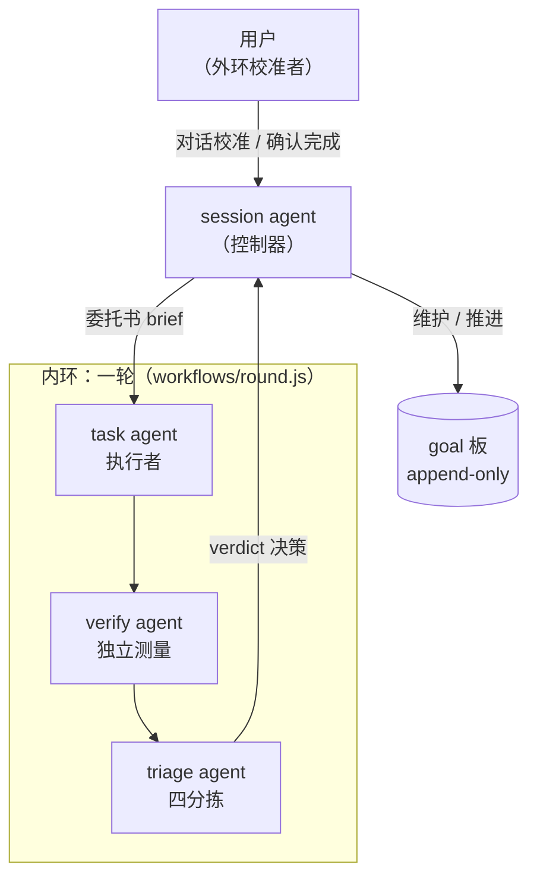

# dsh-cybernetics

[简体中文](README.zh-CN.md) | [English](README.md)

  

**dsh-cybernetics 是一个把多 agent 协作明确设计成控制回路的 DSH 插件**：session goal 作为 agent 的思考产物持久存在，task agent 行动、verify agent 测量、triage agent 分诊，controller 在轮间推进，用户通过对话完成外环校准——目标、行动、测量、校准的负反馈闭环。

这套协议得名于维纳的控制论：设定目标（setpoint）、行动、测量输出与目标的偏差、用偏差修正下一次行动。传统的一次性 prompt 是开环系统——目标只活在当前 prompt 里，测量的责任全在人；本项目把回路搬进系统本身，让人从「逐条 prompt 的作者」变成「目标的设定者与外环的校准者」。设计理念详见博客文章《[Cybernetics Agent——人工智能应用的新范式](https://marchliu.github.io/2026/11/03/cybernetics-agent-new-paradigm)》。

- 协议全文：[docs/protocol.md](docs/protocol.md)
- 演进历史：[docs/CHANGELOG.md](docs/CHANGELOG.md)

## 核心概念



| 角色 | 职责 |
|---|---|
| **session agent** | 控制器：识别用户输入、维护 goal 板、启动/收取/取消轮、向用户转述；从不亲自执行任务 |
| **controller** | `src/controller.ts` 的轮间状态机：`startRound`/`foldRound`/`runRound`，按轮推进 subgoal（task → verify → triage），维护审计日志 |
| **task agent** | 执行器：无对话历史的独立 sub agent，面向工作委托书（brief）实际执行，产出结构化交付报告 |
| **verify agent** | 测量仪器：独立于执行者验收，产出结构化 verdict `{met, criteria, gaps, goalItselfQuestionable}` |
| **triage agent** | 分诊：对 verdict 暴露的后续线索四分拣 auto / defer / reject / human |
| **用户** | 外环校准者：对话校准（goal 修订经 session agent 的 `revise` 执行）、裁定 human 类目、确认完成——controller 永不自宣完成 |

**goal** 是一等公民的持久状态（objective + 当前 subgoal + 完整工作委托书），构建在 dsh-goal 服务之上，v0.2 起不再依赖 goal.md 文件。内环（task → verify → triage → subgoal 修正）在目标不变时自动迭代，每轮有连续迭代上限兜底；外环（用户 ↔ session agent）只在目标本身有问题时介入——verdict 的 `goalItselfQuestionable=true` 会禁止自动迭代、强制回对话。

## 功能特性

### 全量 goal 模式（`allGoalsMode`，默认 false）

开启后注入「ALL-GOALS MODE ACTIVE」路由协议：**任何用户请求一律先建 goal 再执行**，session agent 禁止用读工具就地完成任务——哪怕单文件查询或一次计算也走回路。简单只读请求 → `quick` 单轮；复杂分析/写任务 → `full` 多轮渐进（`start` 异步启动 + 逐轮 `collect` 收敛）。关闭模式时提示段与 revise 行为与 v0.6 完全一致。

### 硬门（`hardGate`，默认 true——安装即激活；v0.8.10 起设置卡片可开关）

**热切换（v0.8.10）**：`hardGate` 已是 **volatile** 字段——插件页设置卡片上有实时开关。保存即把新值提交进运行实例，插件随即卸载或重装门禁监听（装配摘工具 + 分发拒绝 + 审批透传），**即时生效，无需重启、无需插件重载**。从关到开的热启按当前 `gateMode` 解析结果接线（显式配置优先，否则结构性 allowlist）。其余门字段（`gateMode`/`gatedTools`/`gateAllowlist`/`gateAllowlistExtra`/`gateApprovalRelay`）仍是非 volatile 配置文档字段，请在 profile 配置文档中维护（保存触发插件重载）。部署注意：本构建首次上线时运行中宿主仍是旧代码——重启宿主一次加载新代码，此后开关即热生效（`lib/client.js` 只需刷新浏览器）。

**生效语义（v0.8.6，默认安全）**：`hardGate` 开启且未配置 `gateMode` 时，门按 **`allowlist`** 运行——顶层 session agent 只保留读 + 对话 + 展示 + goal/控制动词（内置 `DEFAULT_GATE_ALLOWLIST`，可经 `gateAllowlist`/`gateAllowlistExtra` 扩展），所有变更类工具在装配期被**移除**，并在**调用分发层被拒绝**。之所以改为这个默认：旧的 `denylist` 默认是个陷阱——它只隐藏 `gatedTools` 的三个名字（bash/edit/write），`bsk_*`、`taskboard_*`、`schedule_*`、`farm_*`、`uno_*`、`ppt_*`、`config_restore` 以及整个变更工具长尾全都仍可调用，名为硬门、实为半门。`hardGate: false` 与以前完全一致（不装门）；显式配置的 `gateMode` 一律原样尊重；schema 不再给 `gateMode` 设默认值，因此「未设置」与「显式 denylist」可以被区分。

**显式 `gateMode: 'denylist'`（残留风险，需主动选择）**：只移除 `gatedTools` 中的工具名（默认 bash/edit/write）。顶层 agent 至少仍可使用：`bsk_*`（浏览器自动化，含 `bsk_session` 启停）、`taskboard_*` 写操作（create/update/move/comment/checklist/delete）、`schedule_*` 写操作、`farm_*` 服务生命周期（start/restart/stop/register/unregister）、`uno_*` 与 `ppt_*` 生成器、`config_restore`、`subagent`/team 派生、`knowledge_save`、`job_kill`——凡未被列入 `gatedTools` 的都在，且这个集合随每个新装插件增长，denylist 永远不可能完备。只有在你清醒接受该风险时才显式选择它（例如确实要 session agent 管理服务），并把需要的变更工具逐项补进 `gatedTools`。该模式下注入的 HARD GATE 提示会如实说明「只摘 `gatedTools`」的半门立场，不再假称所有改世界的工具都结构性不可用。

task/verify/triage 子 agent 从不在门禁范围内，保留全部工具。

### 子代理审批透传（`gateApprovalRelay`，默认 true）

宿主在委派边界把每个子代理（workflow 子代理、teammate）的审批策略**钉死为 `never`**——每次审批请求在任何 answerer 看到之前就被确定性拒绝，因此 task agent 需要沙箱越权（典型：写会话工作区之外的路径，如 `~/.dsh/profiles/web/cordis.patch.yml`）时用户根本没机会被询问。`gateApprovalRelay` 开启时（默认，hardGate 伴随项），插件做两件事：

1. **创建时解除子代理策略钉死**——监听 `agent/created`，对委派子代理在其 session 上追加一条持久 `approval/policy {policy:'ask'}` 事件（宿主的折叠规则保证后写事件覆盖委派种下的钉死值）。没有这一步，审批服务会在任何 answerer 运行之前就把请求确定性拒绝成 `rejected`。
2. **在顶层 session agent 上重新发起请求**——插件把 `approval/request` answerer 注册为**最外层**（`prepend: true`），这正是最后一跳的修复点：宿主的 `api-remotes` 在启动时（早于所有用户插件）注册了 `approval/request` 转发器，浏览器审批 answerer 会 claim 子代理请求并等待一张"用户根本看不见"的子会话面板、永不调用 `next()`——因此注册在其后的转发器永远轮不到执行。抢在最外层运行后，插件沿持久 `parentSession` 链找到子代理的**顶层活祖先**，直接调用宿主的 `ApprovalService.request`：请求以原生**允许一次 / 拒绝**面板出现在用户正在看的那个会话里，并在该 session 的 `approval/asked` + `approval/decided` 审计对中留痕。子代理的 tool call id 不向上转发；面板标题（本地化 `displayReason`）会写明是哪个子代理发的请求。

**回退链与 `unavailable` 语义（v0.8.8）**：若顶层回合已关闭（continuable 子代理比父回合活得久），或原生面板应答 `unavailable`（没有应答端 claim 该请求——例如 frame 根本没被浏览器认领），relay 会继续回退到同一顶层 agent 上**可见的** `ask_user_question` 卡片（「子代理审批透传」）——原生 `unavailable` **不是**终态。仅当问题卡片通道也不可用时才以终态 `unavailable` 结束；完全没有活的顶层 agent 则回落原生应答链。拒绝语义始终显式：转发失败答 `rejected`、子代理已中止答 `cancelled`，子代理模型总能经自己的审批审计对拿到真实结果，绝不会静默成功。

**可观测性 / 排障（v0.8.9）**：relay 每次决策记录两处——宿主 logger 一行 `cybernetics approval-relay: path=… outcome=… root=… elapsed=…ms`（无 logger 时 `console.debug` 兜底），以及 `<workspace>/.cybernetics/relay-log.jsonl` 追加一条 JSON（`{ts, root, path, outcome, elapsedMs}`）。该文件是验收时的**落盘事实**，无需宿主 stdout 或浏览器 console 即可直接读取。`path` 取值：`native-panel`（顶层原生允许一次/拒绝面板）、`question-card`（可见的回退卡片）、`next-passthrough`（无活顶层 agent → 原生链）。若子代理快速失败且审计为 `decided unavailable` 而 `relay-log.jsonl` **一条记录都没有**，说明请求根本没到 relay（先确认宿主确实重载了插件构建）；若出现 `path=native-panel outcome=unavailable` 后跟 `path=question-card` 两条，说明 frame 离开了宿主但浏览器没有认领——此时用户仍能看到问题卡片。另注：问题卡片回退通过 `ctx.get` 解析宿主的 `userQuestions` 服务（免 inject 的反射式读取，与 `dsh-plan-mode` 同法）；旧构建用普通属性访问解析，而 cordis 对未 inject 的服务属性访问会直接抛错——v0.8.8 真机失败（「卡片从未出现、12ms 内终态 unavailable」）正是这个原因。

设 `gateApprovalRelay: false` 可回到严格确定性拒绝的立场（CI/无人值守部署）。该字段是 hardGate 伴随项，属**非 volatile / 配置文件维护**字段：请直接在 profile 配置文档中维护，保存触发插件重载。

宿主侧证据（文件:行号）、被否决的方案与复现方式记录在 [docs/approval-relay-investigation.md](docs/approval-relay-investigation.md)；`test/relay-host-probe.mjs` 用真机 cordis waterfall + 真机 `ApprovalService` + 本插件 `apply()` 做回归探针。

### append-only goals 与 revise 决策树

goal 一经存在不再原地修改。`revise` 是唯一的改目标动词（必填 `reason`）：创建带 `parentGoalId` 的新 goal 并立即启动其第 1 轮，旧 goal 置 `superseded` + 记录 `supersededBy`；每次修订追加审计行到 `.cybernetics/revisions-<新goalId>.jsonl`。v0.7 起 `abortPrevious` 缺省时按自动决策树裁定（纯函数 `decideAbort`，依据 goal 板 running 状态）：

- (a) 旧轮在跑且修订改写目标本身（objective/depth 变化）→ **自动中止旧轮**；
- (b) 旧轮在跑但目标不变（仅 brief/title/role 修正）→ **等待旧轮自然结束**；
- (c) 旧 task agent 已结束 → **直接启动新 goal**。

显式传 `abortPrevious: true/false` 保持人工控制；每次修订的审计行与 `revise` 返回值都携带 `abort: {abort, mode: auto|explicit, basis}`。

### quick / full 双档轮次（depth）

- `quick`：单 task agent 一轮出结果直接反馈，跳过 verify/triage，成本约 1/3，verdict 由任务报告派生；
- `full`（默认）：完整 工作 → 验证 → 分诊 循环，验收通过才交付。协议明令禁止用 quick 抄近路做变更。

### 持久执行者（persistent executor）

`executor: 'ephemeral' | 'persistent'`，与 depth 正交。persistent 用 Agent Teams 的持久 teammate 执行 task 工作：首轮 `spawnTeammate(context:'fresh')` 投生，后续轮只投递**委托书修订**（新增约束/验收标准变化/范围收窄，禁止开放式对话）；full 轮中 teammate 报告直接作为 task 报告，verify/triage 仍以临时 agent 独立运行——验证不继承任务叙述。软集成 Agent Teams（无注入反射 + 异常安全探测），取不到即回退 ephemeral。goal 板持久化到 `<workspace>/.cybernetics/board-<sessionId>.json`，宿主重启后自动 rehydrate，「目标」页签不清空。

### 多 goal 板与「目标 / 控制」客户端页签

同一 session 支持多个并发 goal（插件自有 goal 板；dsh-goal 的单槽降级为焦点 goal）。客户端 `lib/client.js` 提供两个会话页签，经插件自有 session 投影 `cyberneticsGoals` 实时推送、就地更新：

- **「目标 / Goal」**：本会话全部 goal（标题 / 状态徽标 / 第 N 轮 / 当前 subgoal / depth、executor 小标签 / 被取代与修订来源标注），按「未完成在前、已完成在后」两段排序；空板回退 dsh-goal 单 goal 渲染。
- **「控制 / Control」**：递归展示本会话全部 agent（主控 + subagent catalog）的运行状态与各自 goal 视图，顶部汇总运行中数量，并列出每个 goal 的执行者行（状态 + 标题 + executor 临时/持久 + 持久 teammate 名称 + 轮次），与「目标」页签同一数据源。

### 控制模式可视化指示（v0.10.0）

每个会话头部常驻一枚徽标，一眼可见当前控制模式生效态：**绿点 +「开」** = 生效中（本会话 `/cybernetics on` 显式 override，或继承全局 `allGoalsMode`），**灰点 +「关」** = 生效关闭，**暗「…」** = 投影/配置尚未加载（加载态而非错误态）。tooltip 注明生效来源（「本会话显式设置」vs「继承全局配置」）。点击徽标即切换——走的正是斜杠菜单同款 `/cybernetics on|off` 命令通道（宿主 `commands.execute`，不新增服务端 API），写入的是同一条 durable 会话事件、投影实时回流。控制模式生效时，输入框上方显示一条细提示条说明下一次输入的去向，文案随 volatile `inputPolicy` 变化（insert →「新输入将作为外环控制即时插入当前回合」；queue →「新输入将排队为下一轮输入」）。数据联接：会话投影 `cyberneticsMode`（{override: true|false|null}）+ ConfigForm 里的全局 volatile `allGoalsMode`，客户端按与服务端 `resolveMode`（src/sessionMode.ts）一致的规则就地联接——投影只在会话事件时重发布，全局 volatile 翻转无法抵达服务端算好的生效值，而两个输入在客户端都是响应式的。文案双语（zh/en）。仅客户端改动：宿主重启（客户端模块图启动时构建）+ 刷新浏览器后生效。

### 插件页配置卡片

`src/index.ts` 导出 schemastery `Config` schema，它决定宿主设置传输层服务与接受哪些字段（仅 `.volatile()` 字段）；卡片 UI 本身由 `lib/client.js` 绘制，注册 `plugins.item` / `plugins.bundle.config` / `plugins.row.config` 三个席位（bundle 详情页与组件详情页都能配置）。**这张卡片是本插件设置在 GUI 中的唯一 surface**：宿主「插件」页对插件配置完全交给 slot 卡片渲染、自身一个字段都不画，@deepseek-ai/dsh-client-ui-settings 只提供 `configForms` 服务（传输层）而非通用字段渲染器——因此 v0.8.1 起卡片渲染全部 volatile 字段的可编辑控件（v0.17 起共 16 个）：全目标模式开关、硬门开关、**智能选择 Agent 配置开关**、**预置方案下拉框**及其推荐请求模型字段、task/verify/triage 各自的「模型 + 思考强度」配对分组、子目标轮数上限与并行轮数上限数字框。`roles` 表**不在卡片上**（v0.8.4）：在 GUI 里手工编辑 JSON 对象对用户不友善，roles 改为非 volatile——面板不再服务也不接受写入——改经 profile 配置 yaml 直接配置（见下文「roles 高级配置」小节）。volatile 字段保存即时生效（loader 直接提交进运行实例，不 remount）；非 volatile 字段保存触发插件行 remount（需宿主重载）。写入落点是用户 patch 行（profile `cordis.patch.yml` 的 `{id, name, config}` 行）。

### agent 模型选择

- **扁平字段**：`taskAgentModel` / `verifyAgentModel` / `triageAgentModel`（「provider/model」或裸模型名，volatile）；**留空 = 与 session agent 一致**（继承语义）。保存后下一轮 goal 即生效，无需重载。triage 角色读 task/verify 结果输出本轮收敛决策（met/continue/human-input 等）；quick 轮完全跳过 verify/triage，`triageAgentModel` 只在 full 轮生效。v0.8.3 起三个字段为下拉加持：`<datalist>` 由宿主实时模型目录驱动（`remote.session.modelCatalog`——与官方「子智能体」设置页同一数据源，`llm/adapters-updated` 事件时刷新），同时保留手工输入（datalist 输入框接受任意文本）。配置值已不在目录中（如该模型订阅被删除）时，卡片显示「不可用——运行时将回退到 session agent 模型」警告并附一键**清除**（显式 unset 写入——绝不静默改写已存配置）；运行时回退即 v0.8.0 的 `callRoleAgent`（AGENT_START `no subagent provider registered` 覆盖 provider 被删；模型级「model not found / unknown model」报错已并入 v0.8.3 的可用性模式表）。
- **roles 表**：按角色覆盖 sub agent 模型（`default`/`verify`/`triage` 固定槽位 + 任意命名任务角色）。v0.8.4 起属高级配置，直接编辑 profile 配置 yaml 维护，不再上设置卡片——见下方「roles 高级配置」小节：

```yaml
- id: dsh-cybernetics
  config:
    roles:
      default: { provider: zai-coding-cn, model: glm-5.3 }
      verify:  { provider: zai-coding-cn, model: glm-5.3 }
      writer:  { provider: zai-coding-cn, model: glm-5-turbo }
```

- **调用级回退（v0.8）**：为某角色设定的模型无法正常调用时——限额/quota 耗尽、网络不可达、provider 报错等**可用性失败**——不再让整个 goal 轮失败：`workflows/round.js` 撤销该角色的 provider/model 覆盖，以 **session agent** 的模型配置重试该角色的子 agent 一次。判定信号来自 workflow runtime（`@deepseek-ai/dsh-workflow-ptc`）`agent()` hook 的错误类型/消息：抛出的 `WorkflowError`（`AGENT_START` 恒算；`AGENT_RESULT`/无 code 错误需消息命中 quota/鉴权/5xx/网络/provider 模式），或返回 `null`（runtime 把子 run `stopReason ≠ "completed"` —— LLM 调用中途失败最常见的形态——压成 null 且不透传原因；仅当配置了覆盖时重试）。**逻辑失败永不换模型**：task agent 正常交付 `done=false` 报告、verify 返回未达成 verdict 都原样流转；非可用性错误（schema/option/cap 守卫错误）原样上抛。每次回退记录进轮结果的 `fallbacks` 数组（`{role, from, trigger, reason}`），narrate 进 `workflow/log`，随 `.cybernetics/round-*.json` 审计日志落盘，并追加进 `cybernetics` 工具结果的决策 note。配置语义向后兼容：留空 = 继承 session agent（无回退必要）；已配置 = 优先用配置模型，可用性失败时回退。`workflows/round.js` 改动热生效。

### 智能选择 Agent 配置（`smartAgentModelSelection`，v0.16，默认 false）

二元开关（volatile，设置卡片布尔开关，保存后**下一轮 goal** 生效）：开启后，**每轮启动时**（launch 侧，早于任何 task/verify/triage 子 agent 的创建）按本轮任务内容（brief → subgoal → objective）做一次**规则启发式分类**，并从宿主**实时可用模型目录**为每个角色自动选择 provider/model。目标不是给困难任务预警，而是**让简单任务更快、更省资源地完成**（删文件、git 提交这类轮不再占用顶配模型），困难任务仍落顶配。规则与选择逻辑全部在 `src/modelSelection.ts`（纯函数，离线可测）。

- **模型目录来源**：宿主根级 `llm` 服务的 `listProviders()` / `listModels(provider)`——与设置卡片下拉同一份实时目录（`buildModelCatalog` 的数据源），**绝不硬编码模型名**；provider 级失败隔离跳过（与宿主同策略）。软探测：服务缺失 / 属性读取被 Cordis 守卫拦截 / 传输抛错 → 目录视为不可用。
- **档位推导（generic 信号，非白名单）**：模型 id/名称/描述里的**参数量 token**（`8b` ≤12 → 轻量，`30b` ≤40 → 中档，`70b` >40 → 顶配）优先于**命名 token**（mini/flash/lite/… → 轻量；opus/ultra/plus/reasoner/… → 顶配）；无信号 → 中档（仅写作类会选中）。**session agent 当前路由 = 顶配参照**（requestHeader 最新选择优先，options 兜底，与 dsh-subagent 的继承解析一致）。
- **分类 → 分配规则**（优先级 hard > writing > trivial > standard；standard **完全不介入**——本功能的价值在省简单任务的钱，不在扰动常规任务）：

  | 分类 | 命中形态（示例） | task | verify | triage |
  |---|---|---|---|---|
  | trivial | 删除文件并验证不存在 / git commit·push / 重命名 / typo / 格式化 | 目录中第一个轻量档 | 同 task（存在性检查无需高强度） | 同 task（轻量） |
  | writing | 写文档/README/报告/翻译/润色 | 目录中声明写作特长的模型（高>中>轻），没有则继承 | **继承 session 模型**（最强评审） | 轻量档 |
  | hard | Rust 等不常见语言 / 证明非平凡数学命题 / 并发运行时·编译器·共识算法·密码学 / 从零实现引擎 | 独立于 session 路由的顶配档；没有独立顶配 → 继承（session 即顶配） | 同 task | 轻量档（分拣是轻活） |
  | standard | 其余一切 | 继承 | 继承 | 继承 |

- **合并优先级（逐角色）**：折叠后的**显式配置**（roles 表 + 设置面板平面字段，provider/model 任一存在）**恒优先**，智能选择只填补没有显式 provider/model 的行；只钉了思考强度档位（effort-only）的行**不换路由**（档位钉在继承路由上，改路由会失配）。全部未配置时智能选择全权决定；选定模型恰为 session 路由时也保持继承（等效路由 + 保留继承档位）。
- **persistent executor 显式跳过**：`spawnTeammate` 不接受模型覆盖——persistent 轮的 task 行审计为 `skipped` 并写明原因（绝不静默失效）；verify/triage 在 full 持久轮仍走 round.js 照常可选。
- **quick 轮**：只有 task 行（verify/triage 不存在，审计也只产 task 一行）。
- **回退语义**：目录不可用/为空、该分类无合适模型（如部署里没有比 session 更轻的模型）、分类器异常——一律**静默回退现有继承行为**，不报错、不阻断，且每行决策（selected / kept-explicit / kept-inherit / skipped）连同理由写入审计。
- **审计**：每次选择的输入摘要（字符数 + 前 100 字符）、分类结果、目录规模、逐角色决策（含 picked 路由与理由）随轮记录落盘——`.cybernetics/round-<goalId>-<N>.json` 的 `smartSelection` 字段（仿 v0.8 `fallbacks` 先例；round.js 从 args 原样回传，persistent 路径经 executor.ts 同步携带），`collect`/`round` 的工具结果同样可见。示例：

```json
{
  "smartSelection": {
    "enabled": true,
    "taskClass": "trivial",
    "inputChars": 17,
    "inputPreview": "删除 build 目录并验证文件不存在",
    "catalogSize": 2,
    "catalogStatus": "ok",
    "roles": [
      { "role": "default", "decision": "selected",
        "reason": "任务分类 trivial：为 task 角色选择 p-light/qwen-8b（light 档，目录 2 个模型中按执行档位规则选取）",
        "picked": { "provider": "p-light", "model": "qwen-8b" } },
      { "role": "verify", "decision": "selected", "reason": "…（同上，验证强度规则）", "picked": { "provider": "p-light", "model": "qwen-8b" } },
      { "role": "triage", "decision": "selected", "reason": "…（分拣轻量规则）", "picked": { "provider": "p-light", "model": "qwen-8b" } }
    ]
  }
}
```

- **v0.16 不自动分配思考强度**：档位 id 是模型相关的，自动分配需逐选中模型 `resolveModelInfo` 探测（每轮每角色一次适配器 I/O + 额外失败面）；智能选择本轮只选路由，档位留给模型默认或现有平面 effort 字段（显式模型行 + effort 字段可精确固定）。
- **为什么用规则启发式而不是一次廉价模型调用**：宿主确有裸补全面（`ctx.llm.prepareCall().stream()`，session-title-llm 模式），但要求引入 `@deepseek-ai/dsh-llm` 运行时依赖（本插件刻意零依赖）、每轮启动前多一次 provider 往返与整条失败面。确定性关键词分类零成本、离线可测，误分类可经审计发现并由显式配置覆盖——显式配置恒优先是安全底线。

### 预置方案（`presetPlan`，v0.17）

设置卡片新增「预置方案」下拉，共 9 个选项：**根据现有配置自动推荐** + 八家**厂商方案**（OpenAI / Claude / Gemini / DeepSeek / Kimi / Qwen / 火山 Coding Plan / Minimax，全量数据见 `src/modelPresets.ts`）。选择写入 volatile `presetPlan` 字段；插件在 `loader/volatile-update` 上对每次变更**一次性（one-shot）解析**，把结果应用到 task/verify/triage 的扁平模型 + 思考强度字段（即下方各角色分组渲染的字段），结果记录写入 volatile `presetRecommendation`，在下拉框下方渲染。

**作用范围（用户裁定，最高优先）**：**session agent 不在本功能范围内**——session 模型由用户随时自行调整，因此选择方案与自动推荐只写三个子 agent 角色的配置：`src/modelPresets.ts` 的 `ALLOWED_OP_PATHS` 把可写字段结构性地钉死为六个扁平子 agent 字段（三个模型字段 + 三个思考强度字段）；推荐 prompt 明令输出只允许 task/verify/triage 三个键、禁止 session 键（解析器对模型万一直出的 session 键丢弃并显式注明）；各厂商的 session 推荐仅作参考数据保留在注册表（`variant.session`），卡片上常驻「session 由用户自行管理，方案不应用此项」提示，永远不会进入任何写入。

- **厂商方案（数据驱动，`status: 'ready'`）**：每厂商含逐角色模型 + 思考强度 token（异构：OpenAI/Minimax 五档 low/medium/high/xhigh/max、DeepSeek thinking 开关、其余模型默认）、可升级档、可用性 fallback、逐角色 rationale、厂商备注（⚠️ 注意事项——如 Qwen 的「verify 绝不用 Turbo（幻觉共振）」、Kimi 的避开退役 K2、DeepSeek 的「成本不应成为降级 verify 的理由」）与**多变体**（Claude 常规/高要求，Qwen A/B/C，DeepSeek 仅本家/verify 外置，Kimi 长期组合/最高验收质量，火山 A/B）。选择方案应用其**默认变体**（第一个）；结果记录披露所应用变体并列出其余变体。厂商原生模型 id 逐字应用——部署目录中不存在的 id 会显示卡片不可用警告，轮内可用性 fallback（v0.8）保证轮次存活。
- **自动推荐**：探测实时目录（`probeCatalogOptions`，与智能选择同源），构建推荐请求——内嵌目录（唯一可选来源）、跨厂商通用原则（verify 档位不低于 task；verify/task 跨代际跨家族保持独立；verify 不能过度自信；省成本先压 task/triage、verify 最后动且成本不是降级 verify 的理由；triage 轻量）、当前角色配置与全部厂商方案（仅作参考）——随后发起**一次受守卫的一次性 LLM 调用**（`ctx.llm.prepareCall().stream()`；消息与分块收集器内联实现，保持零 `@deepseek-ai` 依赖；路由 = `presetRecommendModel` 或目录首个顶配档）。回复严格解析（模型必须命中目录；逐角色 `reasoningEffort` 经 `ctx.llm.resolveModelInfo` 校验，不支持时降为模型默认并注明），经设置服务写入。任何失败（目录为空/调用失败/回复不可解析/零选择）都降级为带原因的 `degraded` 记录——不应用任何更改、不阻塞任何轮次。
- **选择是一次性的**：重复选择同一项不会再次触发（处理器按最后处理值守卫；跨重启持久化的值不会在启动时重放）。要重复应用某项，先切「（未选择）」再选。

## 安装与使用

### 安装

npm 包名 [`@mars.liu/dsh-cybernetics`](https://www.npmjs.com/package/@mars.liu/dsh-cybernetics)。在 DSH profile 中以 `link:` 方式安装本目录即可——插件对宿主包零运行时依赖（工具注册用裸 JSON Schema + 内联校验），不需要自己的 node_modules；要求 Node >= 23.6。

从源码安装：

```bash
git clone https://github.com/MarchLiu/dsh-cybernetics.git
cd dsh-cybernetics
```

在你的 DSH profile（如 `~/.dsh/profiles/web/`）中 link 安装：

```bash
# profile/package.json 的 dependencies 添加：
#   "dsh-cybernetics": "link:/path/to/dsh-cybernetics"
# 然后在 profile 目录执行：
pnpm install
```

安装后：

- 服务端：`src/index.ts`（`cybernetics` 工具 + 隐式触发提示段）+ `src/controller.ts`（轮间状态机）+ `src/executor.ts`（执行者适配层）；
- 客户端：`lib/client.js`（「目标 / 控制」页签 + 插件页配置卡片），**改动后需重启宿主**（客户端模块图在宿主启动时构建）并刷新浏览器；`src/` 改动需宿主重载；`workflows/round.js` 改动热生效。

### 插件页配置

Web 编辑器「插件」页的本插件卡片上直接配置——v0.8.1 起卡片自身渲染全部 volatile 字段（字段说明见 `Config` schema 的 description）：

- **全目标模式**（`allGoalsMode`，volatile）：开关，保存即时生效，提示段即时重挂；
- **task/verify/triage agent 模型**（`taskAgentModel` / `verifyAgentModel` / `triageAgentModel`，volatile）：下拉加持的文本框——从实时系统模型列表选择（显示 `providerName · provider/model`）或手工输入「provider/model」/裸模型名，回车或移开焦点即保存，留空继承 session agent（triage = 收敛决策角色，仅 full 轮启用）。配置值不在实时模型列表中时显示不可用警告（运行时回退到 session agent 模型）并附一键清除；
- **递归深度 / 并行上限**（`roundsPerSubgoal` 整数 ≥1 / `maxConcurrentRounds` 整数 ≥0，volatile）：数字框，回车或失焦保存，留空恢复默认（`unset` 写入）；
- **roles 高级配置**（`roles`，非 volatile）：profile 配置 yaml 直接维护——见下方小节；
- **硬控制门**（`hardGate`，v0.8.10 起 volatile）：卡片布尔开关——装配期从顶层 agent 摘除写/执行工具，所有变更经 goal 循环完成；保存即时生效（门禁监听热装卸），无需重启；
- **智能选择 Agent 配置**（`smartAgentModelSelection`，v0.16 起 volatile）：卡片布尔开关——每轮启动时按任务内容从实时模型目录为 task/verify/triage 自动选模型（简单任务轻量模型、困难任务顶配）；显式配置的角色模型恒优先，选不到时保持继承并记审计；保存后下一轮 goal 生效——详见「Features → 智能选择 Agent 配置」小节的分类规则表；
- **预置方案**（`presetPlan` / `presetRecommendModel` / `presetRecommendation`，v0.17 起 volatile）：卡片下拉（自动推荐 + 八家厂商方案）+ 推荐请求模型字段——选择方案应用其默认变体的 task/verify/triage 模型与思考强度；「自动推荐」经一次 AI 调用从实时目录产出三角色推荐并写入；作用范围仅三个子 agent 角色，session 配置永不被触碰——详见「Features → 预置方案」小节；
- **其余门字段**（`gateMode`/`gatedTools`/`gateAllowlist`/`gateAllowlistExtra`/`gateApprovalRelay`，非 volatile）：不进入卡片，请在 profile 配置文档中维护（保存触发插件重载）。`gateMode` 无默认值：未设置 + `hardGate: true` 按 `allowlist` 运行；显式 `denylist` 会被尊重，并带有上文记录的残留风险。

### roles 高级配置（profile yaml，agent 指导）

`roles` 字段把子 agent 角色映射到 `{provider, model}` 覆盖（`default`/`verify`/`triage` 固定槽位 + 任意命名任务角色，如 `frontend`）。**何时需要它？** 卡片上的三个扁平字段已覆盖固定三角色；只有要给**命名任务角色**（轮启动时经 `role` 参数传入的角色，如 `writer`/`frontend`）分模型、或需要面板没有覆盖的 provider+model 组合时才需要直接配 `roles`。

v0.8.4 起该字段**不在 GUI 编辑**——在设置卡片里手工编辑 JSON 对象对用户不友善。请直接编辑 profile 配置 yaml（profile 的 `cordis.patch.yml` 用户 patch 行，或 profile 自身配置文档）：

```yaml
# profile 的 cordis.patch.yml——用户 patch 行：
- id: dsh-cybernetics
  name: '@mars.liu/dsh-cybernetics'
  config:
    roles:
      default:  { provider: zai-coding-cn, model: glm-5.3 }
      verify:   { provider: zai-coding-cn, model: glm-5.3 }
      frontend: { provider: zai-coding-cn, model: glm-5-turbo }
```

保存后**需宿主重载**（重启宿主）才生效——roles 已不是 volatile 字段，没有面板实时写入路径。session agent 可以指导你完成：让它帮你改 yaml 行，然后重启宿主。运行时行为不变——扁平面板字段合并覆盖 `roles.default`/`roles.verify`/`roles.triage`，命名角色原样透传，每个角色保留 v0.8 可用性回退。

> **GUI 验证步骤**：(1) 重启宿主并强刷浏览器——`lib/client.js` 改动只在宿主启动时随客户端模块图加载（不重启卡片仍是旧字段集，例如只有「全目标模式」），`link:` 安装的 `src/` schema 同样只在启动时 import；(2) 打开 Web 编辑器「插件」页 → 本插件卡片/详情页，确认六个卡片字段（全目标模式 / task 模型 / verify 模型 / triage 模型 / 递归深度 / 并行上限）齐全、且无 roles JSON 文本域；(3) 改动任一字段（回车/失焦），确认控件不回弹且 profile `cordis.patch.yml` 出现/更新 `{id: dsh-cybernetics, name: '@mars.liu/dsh-cybernetics', config: …}` 用户 patch 行；(4) 会话里跑一轮 goal 验证新值生效（如 roundsPerSubgoal 改为 2 后同一子目标第 2 轮即暂停）。

> **已知宿主缺陷（均已定位）**：① *卡片字段不全* 曾有两层叠加原因：v0.8.1 之前卡片只渲染 `allGoalsMode`（宿主没有通用字段渲染器——本版本已修复，重启宿主 + 刷新浏览器后生效）；早于 v0.7.7 启动的宿主其服务 schema 本身只有 `allGoalsMode` 是 volatile（运行时陈旧——`link:` 安装的 schema 在宿主启动时缓存，重启即愈，见 [docs/CHANGELOG.md](docs/CHANGELOG.md) v0.7.10 第 1 条）。② 保存被拒并报 "dsh: profile reload requires the root Include entry" = 宿主 dsh-app-boot 双模块实例——全局 CLI（npm 树）与 profile 侧 dsh-config-editor（pnpm 树）各持一份模块拷贝，`recompose` 的模块级 WeakMap 守卫（`bootstrapIncludes`）永远 miss，**任何**插件的面板保存都在落盘前被拒；插件仓库内无法修复，需把两侧收敛到同一份模块实例（如把 profile 的 `node_modules/@deepseek-ai/dsh-app-boot` 软链到 CLI 引导用的那份拷贝）或等上游修复（CHANGELOG v0.7.10 第 2 条）。workaround：手工在 profile `cordis.patch.yml` 维护用户 patch 行（如 `- id: dsh-cybernetics` + `config: { roundsPerSubgoal: 3, allGoalsMode: true }`）后重启宿主。v0.7.6 起卡片本身不再吞错：仍被拒时会显示宿主拒绝原文并回弹控件。

### 会话内使用：`cybernetics` 工具

session agent 在会话内通过 `cybernetics` 工具（`toolName` 可配置）驱动回路，隐式触发提示段（`implicitTrigger: false` 可关）会指导它不等显式要求就按输入分类协议调用：

| action | 语义 |
|---|---|
| `start` | 新任务：`{action:'start', title, brief}` 建 goal 并（默认后台）启动第 1 轮 |
| `round` | 阻塞式驱动一轮（对既有 goal 或新建 goal） |
| `collect` | 折叠已完成的后台轮，得到 controller 决策（continue/pause） |
| `revise` | 修订目标：创建新 goal（append-only），`reason` 必填，可选 objective/title/depth/executor/abortPrevious |
| `cancel` | 中止在跑的轮（不改目标；只中止不改目标时用） |
| `list` | 查看本会话 goal 板全部 goal 的状态、轮次与运行句柄 |

配套审计：每轮结构化结果落 `.cybernetics/round-<goalId>-<N>.json`；修订落 `.cybernetics/revisions-<新goalId>.jsonl`；goal 板快照落 `.cybernetics/board-<sessionId>.json`。

## 设计动机与原理

（提炼自博客文章，完整叙事见原文；协议细节见 [docs/protocol.md](docs/protocol.md)。）

- **为什么「goal 是 agent 的思考产物」**：传统范式里人是控制器、模型是执行器，回路只存在于人的脑子里。让 session agent 自己把用户输入整理为持久 goal（用户通过对话校准 agent，agent 修订 goal），目标才成为系统里可跟踪的一等公民状态——反馈回路的第一块积木。
- **为什么 append-only**：目标被悄悄改写，会摧毁「经 goal 跟踪 agent」的全部价值——页签上的目标不再是你当初设定的目标。身份与历史由 goal 链表达，正如 git 用不可变 commit 表达历史；每次修订的 reason + 审计行就是校准的显式变更记录。
- **为什么 verify 独立于 task**：验证者若看执行者的叙述，会退化成「检查自述是否自洽」而非「检查事实是否满足目标」。测量仪器必须独立于被测对象——协议的核心不变量：**上下文是被配给的，不是被继承的**（task 只拿委托书、verify 只拿 goal + 报告 + 证据、triage 只拿 verdict，永不用 `context: 'fork'`）。持久的是身份和 goal 边界，不是会话历史。
- **为什么硬门**：早期的「session agent 不亲自执行」只是提示里的劝告，模型看到琐碎任务就会内联干完。硬门在装配期物理移除执行工具，把劝告变成结构——控制者的全部产出是 goal 和 brief（信息），执行者的全部产出是对世界的改变（行动），可观测性与可控性的边界划在角色上，不依赖模型自觉。
- **振荡防御与升级路径**：每轮连续迭代上限是对「反馈延迟过大导致振荡」的工程化防御；triage 的 human 分拣是控制器为「不可自动处理的扰动」预留的升级路径；`goalItselfQuestionable` 在结构上区分「方向错了」和「执行得不好」。

## 与 DSH 现有机制的关系

- **goal**：不替代——dsh-goal 仍是 durable setpoint 与续跑驱动；本插件是它的工作回路。
- **workflow**：每轮就是一次 `ctx.workflowEngine.start()` run；不新增独立控制机制（构建在 `dsh-workflow` 之上）。
- **完成确认**：controller 永不自宣完成、不代改 goal phase；`met` 也只暂停等用户。

## 已知限制

1. **settings 写入的宿主缺陷**：如「插件页配置」一节所述，该运行时上卡片保存可能被宿主在落盘前拒绝（上游 [#12045](https://github.com/deepseek-ai/dsh/discussions/12045)）；workaround：重启宿主 + 强刷浏览器，或手工 patch 行 + 重启。
2. **volatile 与非 volatile 字段的保存语义差异**：volatile 字段（`allGoalsMode`、v0.8.10 起的 `hardGate`、`taskAgentModel`、`verifyAgentModel`、`triageAgentModel`、`roundsPerSubgoal`、`maxConcurrentRounds`）保存即时生效、不 remount；非 volatile 字段（v0.8.4 起的 `roles`、`gateMode`、`gatedTools`、`gateAllowlist*`、`gateApprovalRelay`、`toolName`、`implicitTrigger`）保存触发插件行 remount，需宿主重载完成。且宿主设置表单只服务也只接受 volatile 路径——运行中宿主的 schema 过旧时，volatile 写也会被拒（重启即愈）。
3. **`link:` 安装注意事项**：客户端 bundle 的注册 id 必须等于 package.json 的 `name`（`@mars.liu/dsh-cybernetics`）；loader 行 id 可用短名 `dsh-cybernetics`。插件需挂在本 profile 的**顶层** loader entries（客户端扫描只枚举顶层行）；`src/` 改动需宿主重载、`lib/` 改动需重启宿主 + 刷新浏览器。
4. 其他协议边界（硬门在装配层不在执行层、dsh-goal 焦点槽不随 superseded 迁移等）见 [docs/protocol.md](docs/protocol.md) 各「已知边界」小节。

## 演进历史

| 版本 | 关键节点 |
|---|---|
| v0.2 | session-goal 模式 + 隐式触发 + 角色化 sub agent + 客户端 goal 页签 |
| v0.3 | 多 goal 板 + 控制者协议 + 异步轮（start/collect/cancel/list）+ 委托书 brief |
| v0.4 / v0.4.1 | 硬门；allowlist 门模式（封住变更工具长尾） |
| v0.5 | 双档轮次 depth（quick / full） |
| v0.6 | append-only goals、持久执行者、多 goal 投影、板持久化与 rehydrate、控制页签执行者行 |
| v0.7–v0.7.8 | 全量 goal 模式 + revise 自动决策树；插件页配置卡片；volatile 模型字段；写入落点取证与保存失败可见化（离线测试 56 项） |
| v0.7.9–v0.7.10 | roles / roundsPerSubgoal / maxConcurrentRounds volatile 化；基于真实宿主源码定位面板渲染（陈旧运行时）与保存拒绝（dsh-app-boot 双模块实例 WeakMap miss）双根因（离线测试 58 项） |
| v0.8.0 | 调用级模型回退：角色覆盖模型可用性失败（限额/网络/provider——判定信号为 workflow runtime agent() hook 的错误类型/消息）时回退 session agent 模型重试一次；逻辑失败不换模型；回退记录进轮结果、workflow/log、审计日志与决策 note（离线测试 64 项） |
| v0.8.1 | 设置卡片覆盖全部六个 volatile 字段——卡片是 GUI 唯一 surface（宿主插件页自身不画字段，dsh-client-ui-settings 是传输服务而非渲染器）；文本/数字/roles-JSON 控件带校验，留空 = 恢复默认（unset），写路径与失败兜底与开关同构（离线测试 66 项） |
| v0.8.2 | 新增 `triageAgentModel` 扁平 volatile 字段（与 task/verify 同构：解析合并进 `roles.triage`，留空 = 继承；triage = 收敛决策角色，仅 full 轮；沿用 v0.8.0 fallback 语义并锁死「无覆盖不重试」）；卡片覆盖全部七个 volatile 字段（离线测试 67 项） |
| v0.8.3 | 模型下拉 + 失效模型处理：三个模型字段改为宿主实时模型目录驱动的 datalist 下拉（`remote.session.modelCatalog`，`llm/adapters-updated` 刷新），保留手工输入；配置的模型在模型设置里删除订阅后，卡片显示不可用警告 + 一键清除（显式 unset——绝不静默自动清除，取舍记录见 docs/CHANGELOG.md），运行时回退到 session agent 模型（模型级删除报错并入 v0.8.0 可用性模式表；provider 删除本就由 `no subagent provider registered` / AGENT_START 覆盖）（离线测试 68 项） |

完整逐版记录与 dogfooding 实测修正（含 2026-11-02 启动链路四次修正、页签渲染两连修等）见 [docs/CHANGELOG.md](docs/CHANGELOG.md)。

## 许可

MIT License，Copyright (c) 2026 MarchLiu。完整许可文本见 [LICENSE](LICENSE)。
