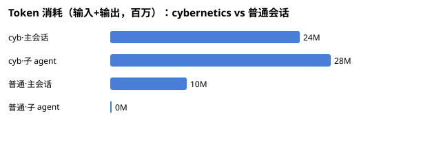
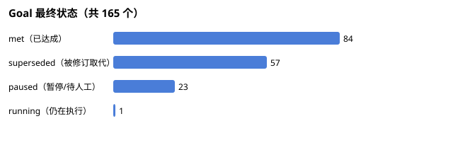
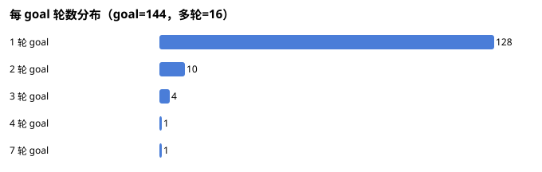
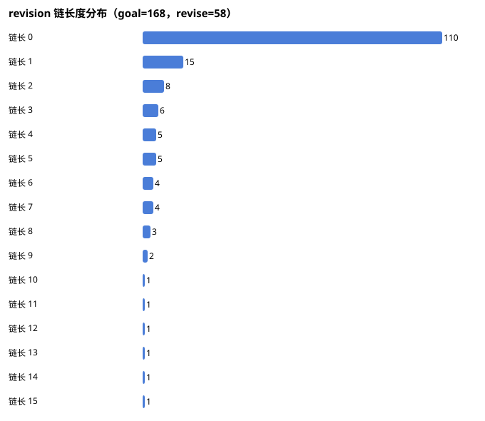
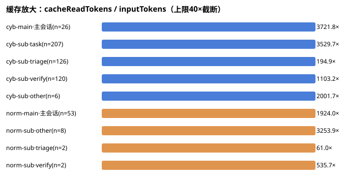
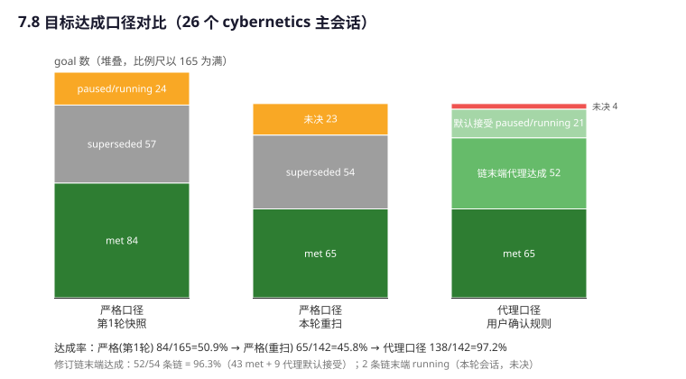
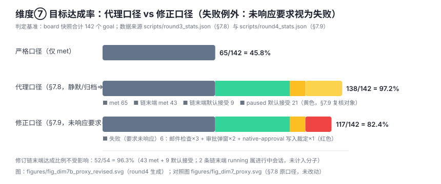
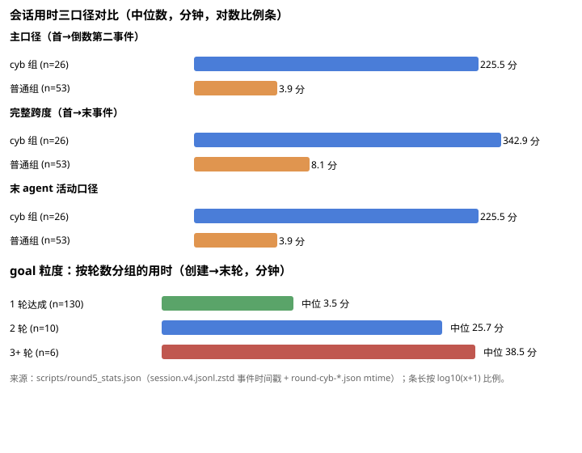

# Cybernetics 插件本周使用统计分析（2026-11-02 ~ 2026-11-05）

> 生成时间：2026-11-05 15:05（Asia/Shanghai）。本报告由独立 task agent 批量解析磁盘数据生成，所有数字可追溯至文末"数据来源"。

## 一、统计口径

- **时间范围**：2026-11-02T00:00:00 至 2026-11-05T15:05（Asia/Shanghai），按会话日志事件时间戳过滤（会话的 first/last 事件时间落在窗口内即计入）。
- **扫描范围**：
  - 会话日志：`~/.dsh/sessions/<工作区编码目录>/session-<id>/session.v4.jsonl.zstd`，共 **1097** 个会话文件全部解析，其中 **544** 个在本周窗口内有活动。
  - cybernetics 插件数据：`/Users/mars/jobs/*/.cybernetics/` 与 `/Users/mars/jobs/*/*/.cybernetics/`（共 9 个工作区），含 `board-session-*.json`（goal 状态）、`round-cyb-*.json`（每轮 task/verify/triage 记录，167 个）、`revisions-cyb-*.jsonl`（goal 修订审计，57 个文件）。
  - 归档台账：`~/.dsh/dsh-session-archive/archive-ledger.json`（101 条归档记录，全部归档时间在本周之前，本周无新增归档；归档会话数据仍留在 sessions 目录中，已一并纳入统计）。
- **token 口径**：来源为每条 `assistant/message` 事件的 `usage.inputTokens` / `usage.outputTokens` 求和（输入部分包含每步重复计入的缓存读上下文，属计费口径，非去重后的唯一 token）。报告中 "token" 均指 input+output 之和。
- **"使用了 cybernetics" 判定**：满足任一即计入——会话日志含 `plugin:cybernetics/goals` 事件；或工作区 `.cybernetics/` 下存在该会话的 `board-session-<id>.json`；或其子会话提示词以 task/verify/goal agent 开头。
- **会话分类**：`origin=subagent` 且带 `parentSession` 的为插件派生的子 agent 会话（466 个）；其余为主会话（78 个）。

## 二、概览（关键数字）

| 指标 | 数值 |
|---|---|
| 本周活跃会话总数（含插件派生子 agent 会话） | 544 |
| 其中主会话 | 78（15 个工作区） |
| 其中使用 cybernetics 的主会话 | **26** |
| 插件派生子 agent 会话（task 201 / verify 131 / triage 126 / 其他 8） | 466 |
| 本周总 token（input+output，全部会话） | 62,630,313（输入 57.7M / 输出 4.9M） |
| cybernetics 会话总 token（26 个主会话及其子 agent） | 52,652,026（84.1%） |
| 普通会话总 token（52 个主会话及其子 agent） | 9,978,287（15.9%） |
| 全周 goal 总数 | 165（met 84 / superseded 57 / paused 23 / running 1） |
| goal 一次达成率（met 且无 revise） | 72/84 = **85.7%** |
| 多轮返工 goal（rounds>1） | 16/140 = 11.4% |
| verify 验收通过率（verdict.met） | 124/151 = 82.1% |

## 三、会话清单（使用 cybernetics 的 26 个主会话）

| 会话 ID | 标题 | 工作区 | 活跃时间 | 用户/助手消息 | 主会话 token | 子 agent 数 | 子 agent token | goal 状态 |
|---|---|---|---|---|---|---|---|---|
| `taskboard-d95492eb-17f1-49d2-a218-9ae0bc9f26e1` | 分析 GitHub PR 内容 | `hypatia` | 09-25 12:01–11-04 20:18 | 30 / 67 | 286,687 | 15 | 526,428 | met:3 / paused:1 |
| `taskboard-98e8548f-14f2-4f0d-a5d8-5324036c669f` | 拉取最新代码变更 | `hypatia` | 09-25 21:01–11-03 21:00 | 10 / 26 | 36,728 | 1 | 65,160 | met:1 |
| `8584c49c-38a7-402a-8900-24bc646c2937` | 验证cybernetics触发机制 | `dsh-cybernetics` | 11-02 16:21–11-04 11:02 | 28 / 253 | 861,399 | 10 | 523,978 | — |
| `422e8d5a-8eb5-4637-b4a9-02a0b12ed967` | 修改 cybernetics 插件以提取任务并驱动 subagent 执行 | `dsh-cybernetics` | 11-02 18:22–11-03 11:19 | 110 / 538 | 2,725,460 | 28 | 2,117,797 | paused:2 / met:12 |
| `02552ea6-ad14-4902-a3f0-749276de4f72` | 插件配置项开发 | `dsh-cybernetics` | 11-02 22:16–11-04 14:04 | 422 / 604 | 8,532,181 | 94 | 7,301,683 | met:13 / superseded:16 / paused:2 |
| `48551c04-d368-4375-afc3-306c25e0891a` | 项目了解与介绍 | `baoyu-design` | 11-03 10:37–11-03 16:59 | 60 / 137 | 903,490 | 13 | 782,388 | met:2 / paused:5 / superseded:1 |
| `d0ae28fa-0866-48c6-8205-497e7efe0a10` | 改进Cybernetics插件配置面板方案 | `dsh-cybernetics` | 11-03 10:48–11-04 17:24 | 55 / 82 | 974,461 | 27 | 2,273,327 | superseded:7 / paused:1 / met:1 |
| `f8f4e5b8-185f-451c-8fbe-37e7aa36d2d4` | 部署 OIDC 生产配置规划 | `zgci.ac.cn/PhotoStory` | 11-03 11:09–11-03 18:55 | 30 / 41 | 388,961 | 16 | 1,035,171 | superseded:1 / met:1 |
| `7d57e4cd-b8e0-4116-b6a4-33a88ee8e252` | 配置 Story 生产服务器 OIDC | `zgci.ac.cn/lab-ops` | 11-03 11:27–11-03 16:42 | 31 / 45 | 209,540 | 9 | 384,027 | superseded:2 / met:1 |
| `cb574b9d-5d40-4af0-80a5-bc91c1bff9fc` | 排查使用旧Key的后台任务 | `zgci.ac.cn/lab-ops` | 11-03 15:33–11-03 16:40 | 12 / 24 | 130,527 | 2 | 192,341 | met:1 |
| `4eaa9b58-6734-456f-9114-fc1e68959ba1` | dsh web session路径分级显示问题分析 | `deepseek-harness` | 11-03 15:35–11-03 18:47 | 36 / 120 | 773,376 | 12 | 624,376 | met:2 / paused:1 |
| `ca35bba7-f6c5-4d7b-8db2-8761c512ef86` | 修改AI API对话key及定时任务 | `zgci.ac.cn/lab-ops` | 11-03 15:55–11-03 21:47 | 63 / 80 | 659,386 | 29 | 1,916,341 | superseded:2 / met:7 |
| `9625c9f9-3628-4a35-a0e0-d7fb0714deb6` | 读一下 @部署 OIDC 生产配置规 | `zgci.ac.cn/lab-ops` | 11-03 19:38–11-03 20:07 | 137 / 144 | 148,495 | 3 | 121,043 | met:1 / paused:1 |
| `455f4823-622a-42a9-906c-adce1cfd5b1a` | 撰写控制论Agent新范式博客 | `marchliu.github.com` | 11-03 23:17–11-04 16:20 | 64 / 163 | 410,106 | 25 | 1,111,765 | superseded:15 / met:1 |
| `a5bd547c-0e31-43ef-8c28-544b183d6ae6` | 生成英文版README并互链 | `dsh-cybernetics` | 11-04 11:38–11-04 15:46 | 10 / 23 | 103,769 | 3 | 131,093 | met:1 |
| `9e7abdf0-de9a-4a1b-a200-fbe24f6d34c9` | 访问测试环境确认 | `zgci.ac.cn/ZGCAI-Mattermost` | 11-04 15:18–11-04 20:59 | 65 / 1097 | 2,600,837 | 12 | 152,734 | met:4 |
| `ac838029-465e-437d-9b58-d6a460e15e3d` | 全目标模式未创建目标排查 | `dsh-cybernetics` | 11-04 17:10–11-05 13:17 | 125 / 279 | 2,799,600 | 93 | 4,811,979 | met:10 / superseded:2 / paused:2 |
| `taskboard-c72e5a02-833f-4492-b485-942f34b5b8d8` | 每小时检查 Gmail 和 Outlook 新邮件 | `deepseek-harness` | 11-04 21:07–11-04 23:09 | 18 / 33 | 112,001 | 3 | 115,268 | met:3 |
| `d7299c92-b135-4bb0-8bb8-bef37ef090da` | 读取凭证文件前三行 | `deepseek-harness` | 11-04 23:09–11-05 00:07 | 19 / 20 | 54,465 | 6 | 272,608 | paused:1 |
| `c5e252df-eb59-45e1-9c61-55be439f83d1` | 读取凭证文件前三行 (1) | `deepseek-harness` | 11-04 23:09–11-05 12:51 | 12 / 14 | 18,608 | 0 | 0 | — |
| `taskboard-7e3af283-6eac-4d3e-9c9b-55d087c61075` | 每小时检查 Gmail 和 Outlook 新邮件 | `deepseek-harness` | 11-05 00:07–11-05 13:09 | 90 / 146 | 1,137,174 | 42 | 2,283,830 | paused:3 / met:11 |
| `799ec920-2f80-4a33-ac7d-ffdfc608c7c6` | 读取并介绍当前项目 | `zgci.ac.cn/Mattermost-Plugins-Dev` | 11-05 10:43–11-05 10:47 | 7 / 10 | 18,430 | 1 | 55,293 | met:1 |
| `7e4a8c3f-215f-4081-8d15-8c16e26f258f` | 寻找附件中的学院Logo墙照片 | `zgci.ac.cn/PhotoStory` | 11-05 11:07–11-05 12:54 | 24 / 49 | 158,824 | 6 | 606,416 | paused:1 / met:3 |
| `5b1b5f9f-1dc9-4a51-bcaf-aedba19d976e` | 分析会话名被分级原因 | `deepseek-harness` | 11-05 12:50–11-05 13:10 | 28 / 64 | 59,222 | 6 | 267,353 | paused:1 / superseded:9 / met:2 |
| `7b11fa71-1221-463e-bedb-1ab90e8ad972` | 分析目标列表重复原因 | `dsh-cybernetics` | 11-05 12:58–11-05 14:12 | 32 / 89 | 211,237 | 7 | 562,795 | paused:2 / superseded:2 / met:3 |
| `a2e26e90-5652-4426-9fa0-2c1902dcba82` | cybernetics插件使用统计分析 | `dsh-cybernetics` | 11-05 14:30–11-05 15:02 | 4 / 2 | 22,932 | 1 | 78,936 | running:1 |

数据来源：会话清单与消息/token 计数取自 `~/.dsh/sessions/**/session.v4.jsonl.zstd`；goal 状态取自各工作区 `.cybernetics/board-session-<id>.json`。

## 四、逐题回答

### 1. 本周会话数与 cybernetics 使用情况
本周窗口内活跃会话 **544** 个（主会话 78 + 插件派生子 agent 会话 466）。其中 **26 个主会话**使用了 cybernetics 插件，分布在 9 个工作区（见上表）：dsh-cybernetics 8、deepseek-harness 6、zgci.ac.cn/lab-ops 4、hypatia / PhotoStory 各 2、baoyu-design / marchliu.github.com / ZGCAI-Mattermost / Mattermost-Plugins-Dev 各 1。归档台账 101 条记录均为本周之前归档，本周无新增归档会话。

### 2. Token 消耗
- 全周合计 **62.63M token**（input+output 计费口径）。
- cybernetics 会话（主+子）：**52.65M（84.1%）**；普通会话：**9.98M（15.9%）**。
- cybernetics 会话平均 936K token/会话 vs 普通 189K（约 **5 倍**）；其中子 agent 占 cybernetics 总消耗的 53.8%（28.3M / 52.7M）。
- 注意：cybernetics 组包含若干长时运行的定时任务会话（如 deepseek-harness "每小时检查邮件"、hypatia taskboard 会话自 09-25 运行至今），会拉高均值；中位数对比为 249K vs 65K（约 3.8 倍）。

### 3. 人机对话回合数
见上表"用户/助手消息"列。cybernetics 会话平均 58.5 条用户消息 / 160 条助手消息（中位数 30.5）；普通会话平均 9.7 条用户消息（中位数 6）。cybernetics 会话的用户消息显著更多，但其中相当比例是定时任务注入（见数据局限第 3 条），**不能全部视为人类介入**。

### 4. goal 创建与修订
本周共 **165 个 goal** 记录在 26 个 `board-session-*.json` 中。修订情况：57 个 `revisions-cyb-*.jsonl` 审计文件（每个恰好 1 行 revise 记录），对应 57 个被修订取代（superseded）的旧 goal——即 **创建 165 个、人工/外环 revise 修订 57 次**（修订率 34.5%）。修订最集中的会话：marchliu.github.com 博客会话（16 goal / 15 superseded，迭代写作）、dsh-cybernetics 插件开发会话（31 goal / 16 superseded）。数据来源：`.cybernetics/board-session-*.json` 的 `goals[]` 与 `.cybernetics/revisions-cyb-*.jsonl`。

### 5. 目标最终达成情况

- **met（已达成）84（50.9%）**：由 verify agent 验收通过或 triage 判定 met。
- **superseded 57（34.5%）**：被 revise 产生的新 goal 取代（旧版本，不是失败）。
- **paused 23（13.9%）**：暂停、等待人类输入或后续会话。
- **running 1（0.6%）**：即本报告所属会话的 goal，仍在执行。
- 用户确认维度：插件状态集中无 "completed" 字段，`met` 由 agent 侧 verify/triage 判定产生；**日志中未见独立的用户确认完成动作事件，无法判定每个 met 是否经用户最终确认（数据不足）**。

### 6. 一次达成（无 revise）的 goal
**72/84 = 85.7%** 的达成 goal 未经过 revise 一次达成（met 且 `revisions==0`）。若把 superseded 视为"需修正后重立"，未修订直接达成的比例为 72/165 = 43.6%。

### 7. 各角色子 agent 的平均步数与 token

| 角色 | 会话数 | 平均步数/会话 | 平均 token(input+output)/会话 | 平均时长 |
|---|---|---|---|---|
| task agent | 201 | **27.4** | ≈ 83.3K（in 14.38M + out 2.36M） | 5.4 分钟 |
| verify agent | 131 | 8.3 | ≈ 53.8K（in 6.24M + out 0.81M） | 2.1 分钟 |
| triage (goal) agent | 126 | 1.7 | ≈ 31.4K（in 3.71M + out 0.25M） | 0.6 分钟 |

数据来源：子会话日志的 `step/start` 计数与 `assistant/message.usage` 求和（`~/.dsh/sessions/**`，按 `parentSession` 归属、按收件箱提示词前缀识别角色）。

### 8. 控制开销评估

| 维度 | 证据 | 结论 |
|---|---|---|
| **token 开销** | cybernetics 会话占总 token 84.1%，均值约为普通会话 5 倍（中位数 3.8 倍）；子 agent 共 28.3M，其中 task 16.7M、verify 7.0M、triage 4.0M、其他 0.7M | verify+triage 控制环节约占插件总开销 21%，其余是 task agent 更长的自主执行 |
| **人类介入** | cybernetics 会话用户消息均值 58.5 vs 6.0（普通），但含大量定时注入；triage 共产生 174 条 human 决策项 + 137 条 defer + 105 条 auto | **无法直接判定人类介入更少（数据不足）**——用户消息口径被定时任务污染；triage 把约 40% 的后续事项明确路由给人类决策 |
| **自动化程度** | 插件会话中子 agent 步数占总步数 63%（7142 / 11323） | 自动化比例高，主会话主要承担编排 |
| **工作质量** | verify 首轮通过率 82.1%（124/151）；goal 一次达成率 85.7%（按 met 计）；task agent 自报 done 率 86.8%（132/152），约 13% 轮次未完成触发返工（16 个 goal 跑了 2~7 轮） | 存在实质返工（11.4% goal 多轮），但多数经第 2~3 轮修复 |
| **时间开销** | cybernetics 会话中位时长 346.6 分钟 vs 普通 7.3 分钟——但前者多为跨天长会话（定时任务），子 agent 单轮平均仅 5.4 / 2.1 / 0.6 分钟 | **无法得出"更耗时"的结论（口径不可比）**；插件单轮执行本身是分钟级 |

**总体评估**：cybernetics 本周承载了团队的工程开发主力（84.1% token），其控制回路（verify/triage/revise）以约插件总量 21% 的额外 token 为代价，换来了 82.1% 首轮验收通过与 85.7% 的 goal 一次达成率；返工率 11.4% 说明 verify 确实在拦截未完成任务。"是否减少人类介入"因消息口径污染与缺少用户确认事件，无法量化判定。

## 五、数据局限说明

1. **长会话跨窗口**：2 个 hypatia taskboard 会话自 09-25 运行至今，其全部历史 token 被计入本周口径（约 0.32M，占比小但存在）。
2. **token 口径**：inputTokens 含每步重复的缓存上下文，为计费口径而非唯一 token；`totalTokens` 字段含缓存读重复放大（数值不可用，未采用）。
3. **用户消息污染**：定时任务（scheduled reminder / taskboard 周期执行）以 user 消息形式注入，"人类介入"无法从 user 消息数中可靠区分；日志未见独立的用户确认事件类型。
4. **goal 与文件不完全对齐**：167 个 round 文件中 1 个损坏/无法匹配 goal；部分 round 文件无 verdict（quick 轮跳过 verify）。
5. **归档会话**：本周无新增归档，归档数据本身已可从 sessions 目录读取，不影响统计。
6. **会话时长**：插件会话多为跨天长会话，与普通即用即走会话的时长不可直接比较。

## 六、数据来源路径汇总

- 会话统计：`~/.dsh/sessions/<ws>/session-<id>/session.v4.jsonl.zstd`（1097 个文件全量解析）
- goal 状态：`/Users/mars/jobs/`{hypatia, dsh-cybernetics, deepseek-harness, marchliu.github.com, baoyu-design, zgci.ac.cn/lab-ops, zgci.ac.cn/PhotoStory, zgci.ac.cn/ZGCAI-Mattermost, zgci.ac.cn/Mattermost-Plugins-Dev}`/.cybernetics/board-session-*.json`
- 每轮执行：同目录 `round-cyb-*.json`（167 个）
- 修订审计：同目录 `revisions-cyb-*.jsonl`（57 个）
- 归档台账：`~/.dsh/dsh-session-archive/archive-ledger.json`
- 图表：`figures/tokens_split.svg`、`figures/agent_roles.svg`、`figures/goal_status.svg`

## 七、扩展维度分析（第 2 轮追加，2026-11-05 15:37）

> **统计性质声明**：本章全部结论为**描述性统计，非因果推断**；两组样本极不均衡且偏小（cybernetics 组 26 个主会话 vs 普通组 52 个主会话），分桶后单桶样本量 4~38，所有对比只反映本周观察到的相关，不构成对插件效果或成本的因果结论。
> **数据快照说明**：本轮于 15:21 重新全量扫描，比第 1 轮（15:05 快照）新增了其间产生的会话/轮次：会话文件 1097→1106、窗口内活跃 544→550、round 文件 167→171、revisions 57→58；**cybernetics 主会话仍为 26 个、board 26 份不变**。本章数字均基于 15:21 快照（脚本：`scripts/round2_analyze.py`，中间结果：`scripts/round2_stats.json`），与第一至六章（15:05 快照）存在上述微小漂移，属正常追加，不回改前文。

### 7.1 对照偏差：按任务规模分桶（维度①）

按"主会话 + 其全部子 agent"的 token 总量把 79 个主会话分成 4 桶，桶内对比两组的 token 中位数与会话时长中位数（时长 = 日志首末事件跨度，跨天长会话会拉高，仅作参考）：

| 桶（会话总 token） | cyb 组 n | cyb token 中位 | cyb 时长中位 | 普通组 n | 普通 token 中位 | 普通时长中位 |
|---|---|---|---|---|---|---|
| <200K | 4 | 87.8K | 415.1 分 | 38 | 50.5K | 3.0 分 |
| 200K–1M | 11 | 326.6K | 74.2 分 | 10 | 245.3K | 2327.1 分 |
| 1M–3M | 6 | 1.60M | 367.3 分 | 5 | 1.36M | 780.5 分 |
| ≥3M | 5 | 4.84M | 1206.6 分 | 0 | — | — |

- 同桶内 token 中位数差距明显小于第六章的整体均值差（5×）：**<200K 桶 1.74×、200K–1M 桶 1.33×、1M–3M 桶 1.18×**。即第一轮"cybernetics 会话约 5 倍 token"的总体差距，有相当部分是**任务规模构成差异**（cyb 组大任务占比高）而非纯单位成本放大；同规模下放大系数约 1.2~1.7×。
- 时长中位数不可比：普通组 200K–1M 桶被 2 个跨天定时任务会话（Gmail/GitHub 检查）拉高到 2327 分；剔除后两组同桶时长量级相近。
- 普通组没有 ≥3M 会话：本周最大的普通任务也远小于 cyb 组头部任务，**大任务维度的对照完全缺失（数据不足）**。
- 来源：`scripts/round2_stats.json` 的 `dim1_buckets`（原始数据 `~/.dsh/sessions/**/session.v4.jsonl.zstd` 的 usage 求和）。

### 7.2 人类注意时间 vs 墙钟时间（维度②）

**口径**：先从 `user/message` 事件中剔除机器注入（`source.kind ≠ 'user'` 的时间上下文/运行时上下文/技能目录/goal 轮次注入，以及 kind=user 但文本为定时任务提示、委托书模板、同会话逐字重复的消息），剩下的视为"真实用户消息"。然后：
- **会话跨度** = 日志首末事件时间差（墙钟）；
- **有人值守时长** = Σ 每条真实用户消息时刻与其**前一条 agent 活动事件**（assistant/tool/step/turn 结束）时刻之差——即 agent 停下来等人冒泡的时间；
- **无人值守时长** = 跨度 − 有人值守时长。

| 组 | 会话数 | 有真实用户消息 | 无人值守占比中位 | 无人值守占比均值 | 加权（按时长） |
|---|---|---|---|---|---|
| cybernetics | 26 | 23 | **80.8%** | 71.6% | 97.3% |
| 普通 | 53 | 25 | **100%** | 89.3% | 80.6% |

- 按会话中位数：cyb 组 80.8% vs 普通 100%——cyb 会话有更多真人"冒泡"节点，等待人类的时间占比更高（有人值守时长中位 121.6 分 vs 普通组 1.8 分，但两者跨度中位差 43 倍，绝对值不可比）。
- 按时长加权后反向（cyb 97.3% vs 普通 80.6%）：因为 cyb 组包含数个**连续运行多天**的 taskboard 定时任务会话（单个跨度 3.9 万~5.8 万分钟、几乎零人工），把加权值拉满。两种口径都列出，**结论是"无人值守占比高度依赖会话类型，两组都存在几乎全程无人值守的定时任务会话"**，无法支持"cybernetics 减少人类驻守时间"的因果判断。
- 局限：日志只有 agent 活动与消息到达时刻，不含"人类正在打字"的时长；真人消息的响应延迟把用户阅读时间也计入了"有人值守"。
- 来源：`dim2_unattended`（逐会话 span/idle/ratio）。

### 7.3 介入时点分类（维度③）

**启发式口径（如实标注）**：把 26 个 cyb 主会话的 276 条真实用户消息按位置与文本特征分三类——首条消息=目标定义；含纠正性词汇（不对/错了/问题/报错/没有/重新/fix/wrong 等，词表偏宽）=中途纠偏；末条且含确认词（可以/好的/确认/同意/ok 等）=结尾验收；其余=other。**未做 revise 事件对齐**（消息与 `revisions-cyb-*.jsonl` 的 revise 记录之间无 id 关联，只能启发式），分类准确率未人工抽验，数字仅作量级参考。

| 类别 | 条数 | 占比 |
|---|---|---|
| 目标定义（首条） | 23 | 8% |
| 中途纠偏（词表启发式） | 91 | 33% |
| 结尾验收（末条+确认词） | 16 | 6% |
| 其他（追问/补充/授权等） | 146 | 53% |

- 26 个会话中 **16 个（61.5%）至少有 1 条纠偏类消息**；另有 3 个会话全程无真实用户消息（纯定时任务驱动）。
- goal 粒度（更可靠）：按 `revisions-cyb-*.jsonl` 的 `from→to` 链，**168 个 goal 中 58 个（34.5%）被 revise 修正过**，即每 3 个 goal 约有 1 个经历中途纠偏；会话级启发式把"会话出现过纠偏词"记到其全部 goal（142/167），口径粗，仅供参照。
- 来源：`dim3_totals` / `dim3_class` / `dim3_goal`、`/Users/mars/jobs/*/.cybernetics/`。

### 7.4 verify 打回与返工（维度④）

171 个 `round-cyb-*.json`（144 个可按文件名解析出 goalId）：

| 指标 | 数值 |
|---|---|
| verify verdict = met（通过） | 126（73.7%） |
| verify verdict = 未通过（打回） | 28（16.4%） |
| 无 verdict（quick 轮跳过 verify） | 17（9.9%） |
| 多轮 goal（rounds>1，即被返工） | 16 / 144 = 11.1% |
| 返工轮数总和（第 2 轮及以后） | 27 轮 |
| 每 goal 轮数分布 | 1 轮 128 / 2 轮 10 / 3 轮 4 / 4 轮 1 / 7 轮 1 |
| triage 决策项 | human 178 / defer 140 / auto 107 |

- **控制循环拦截率**：16.4% 的完整轮被 verify 打回，与 11.1% 的 goal 发生实际返工相互印证——verify 确实在持续拦截未达标交付，且 10 个 2 轮 + 6 个 3~7 轮的 goal 大多在 2~3 轮内收敛。
- 打回率（16.4%）高于第一轮口径的"首轮通过率 17.9%"（分母含 quick 轮），两者一致。
- 来源：`dim4`（`/Users/mars/jobs/*/.cybernetics/round-cyb-*.json` 的 `verdict.met` 与文件名轮号）。

### 7.5 渐进度分布（维度⑤）

- **每 goal 轮数直方图**见 7.4 图（1 轮 88.9%，≥2 轮 11.1%，最长 7 轮）。
- **revision 链长度**（goal 被 revise 取代的代际深度，`revisions-cyb-*.jsonl` 的 parentGoalId=`from` 追链）：168 个 goal 中

| 链长 | 0 | 1 | 2 | 3 | 4 | 5 | 6 | 7 | 8 | 9 | 10 | 11 | 12 | 13 | 14 | 15 |
|---|---|---|---|---|---|---|---|---|---|---|---|---|---|---|---|---|
| goal 数 | 110 | 15 | 8 | 6 | 5 | 5 | 4 | 4 | 3 | 2 | 1 | 1 | 1 | 1 | 1 | 1 |

- 65.5% 的 goal 是链头（未经修订），34.5% 处于修订链上；**最长链 15 代**（marchliu.github.com 博客会话的迭代写作 goal），呈明显长尾——少数 goal 被连续改写十余次，而多数 goal 一次立住。
- 来源：`dim5`（由 58 条 revise 记录建 parent→child 图后对全部 goalId 追链）。

### 7.6 token 口径细分与缓存放大（维度⑥）

日志 `assistant/message.usage` 含 `inputTokens / outputTokens / cacheReadTokens / totalTokens`（**存在 cacheRead 字段**，第 1 轮未使用）。注意 `cacheReadTokens` 是每步重复读到的缓存上下文量，**远大于计费口径的 inputTokens**（inputTokens 为非缓存部分），故用 cacheRead/input 比值衡量"同一上下文被重复加载的放大倍数"：

| 组·角色 | 会话数 | input（非缓存） | output | cacheRead | 缓存/输入比 |
|---|---|---|---|---|---|
| cyb 主会话 | 26 | 22.56M | 0.97M | 839.5M | **37.2×** |
| cyb·task agent | 207 | 14.58M | 2.42M | 514.5M | **35.3×** |
| cyb·verify agent | 120 | 5.82M | 0.74M | 64.2M | **11.0×** |
| cyb·triage agent | 126 | 3.70M | 0.25M | 7.2M | **1.9×** |
| 普通主会话 | 53 | 10.25M | 0.44M | 197.3M | 19.2× |
| 普通子会话 | 12 | 0.62M | 0.04M | 16.9M | 27.0× |

- **控制循环的缓存放大确实存在但低于执行环节**：verify（11.0×）低于 task（35.3×），triage 仅 1.9×（平均 1.7 步/轮，几乎无复用）。即 verify/triage 的 7.05M 非缓存输入之外，主要重复成本来自 task agent 自身的多步循环，而非 verify/triage 反复重读上下文。
- cybernetics 主会话 37.2× 高于普通主会话 19.2×：长会话 + goal 轮次注入使上下文重复加载更多，这是第六章"控制开销"在缓存维度上的具体化；若计费对缓存读有折扣，实际成本放大远小于表面 token 比。
- 来源：`dim6`（同上日志文件 usage 字段）。

### 7.7 本章数据来源与局限

- 脚本与中间结果：`scripts/round2_analyze.py`、`scripts/round2_stats.json`（可复现全部数字）。
- 原始数据：`~/.dsh/sessions/**/session.v4.jsonl.zstd`（1106 个文件全量解析，550 个窗口内活跃）；`/Users/mars/jobs/{hypatia,dsh-cybernetics,deepseek-harness,marchliu.github.com,baoyu-design,zgci.ac.cn/lab-ops,zgci.ac.cn/PhotoStory,zgci.ac.cn/ZGCAI-Mattermost,zgci.ac.cn/Mattermost-Plugins-Dev}/.cybernetics/`（board 26、round-cyb 171、revisions-cyb 58）。
- 局限：① 分桶与无人值守均为描述性对比，样本 26 vs 52，不做因果与显著性检验；② 介入分类与机器注入剔除依赖文本启发式，未人工标注校验；③ ≥3M 桶、大任务对照、用户确认完成事件均**数据不足**；④ 15:21 快照与第 1~6 章 15:05 快照存在少量漂移（见本章头部说明）。

### 7.8 用户确认代理口径下的目标达成率（第 3 轮追加，2026-11-05 16:30）

第 5 章遗留问题：日志中无独立"用户确认完成"事件，达成率只有 agent 侧 met 口径。本章采用**用户确认的代理口径**（用户原话："可以简单的认为，一个小时内没有再追加内容，或者最终被存档的，都是完成了会话中的 goals"），对 26 个 cybernetics 主会话逐一判定。

**判定规则**（对每个会话独立判定，满足任一即视为"已收尾"）：

- **规则 A（静默收尾）**：会话最后一条事件距快照时刻（2026-11-05 15:21 +08:00，与 7.x 章一致）≥ 1 小时无追加；
- **规则 B（归档）**：会话出现在归档台账 `~/.dsh/dsh-session-archive/archive-ledger.json`（共 101 条记录）。

**对已收尾会话中 goal 的归类**：met → 达成；paused/running → **代理默认接受**（单独计数，不与 met 混淆）；superseded → 沿修订链追到链末端 goal，按链末端状态判定（末端 met → 整链达成；末端 paused/running 且所在会话已收尾 → 整链代理达成）。

#### 结果

| 指标 | 数值 | 来源 |
|---|---|---|
| 满足代理确认条件（A∨B）的会话 | **24 / 26** | 24 个命中规则 A；规则 B 命中 0 个（台账 101 条记录无一属于这 26 个会话） |
| 未满足的会话 | 2 | `session-a2e26e90`（running，即本报告会话）、`session-taskboard-2359da6d`（最后事件距快照仅 0.1h） |
| goal 总数（本轮重扫 board 口径） | 142 | 26 个 board 快照合计（第 1 轮口径 165，见下方漂移说明） |
| 严格口径达成率（第 1 轮） | 84/165 = **50.9%** | 第 5 章原始快照 |
| 严格口径达成率（本轮重扫） | 65/142 = **45.8%** | `scripts/round3_stats.json` |
| **代理口径达成率** | **138/142 = 97.2%** | 同上 |
| 被代理口径新认定为达成的 goal | **73 个** | 21 个 paused"默认接受" + 43 条链末端 met + 9 条链末端默认接受 |

**"默认接受"的 paused goal 清单（21 个，分布在 11 个会话）**：`02552ea6`×2（写入落点 patch 行×2）、`422e8d5a`×2（TeamExecutor 适配层、多 goal 页签）、`48551c04`×5（CJK 上游更新、介绍幻灯、CJK 回退验证、slides 服务器重启×2）、`4eaa9b58`×1（better-workspace 0.37.2）、`5b1b5f9f`×1（会话名多级路径分析）、`7b11fa71`×2（重复 goal 归因、brief 未落盘排查）、`ac838029`×2（off 键下拉故障、审批弹窗实弹测试）、`d0ae28fa`×1（插件配置面板）、`d7299c92`×1（native-approval-test）、`taskboard-7e3af2`×3（邮件检查×3）、`taskboard-d95492`×1（hook 四缺陷）。完整清单见 `scripts/round3_stats.json`。

**修订链视角（54 条链）**：58 次 revise 记录分布在 54 个 `revisions-cyb-*.jsonl` 链文件中。链末端 goal：met 43 条、paused（所在会话已收尾→代理达成）9 条、running 2 条（均指向本报告会话的当前 goal，未决）。**链末端达成比例 = 52/54 = 96.3%**——即"修正之后最终都达成了"在代理口径下基本成立；例外是本轮正在进行中的 2 条链。

#### 口径局限（必须与数字一起读）

1. **放弃 ≠ 满意**：静默 1 小时只能证明"用户没有继续"，不能证明"用户对结果满意"。21 个"默认接受"的 paused goal 中多数标注为等待人类输入（如审批弹窗测试、服务器重启验证），用户可能只是搁置而非认可。
2. **paused 可能是显式等待**：goal 状态 paused 本身常表示"暂停等人类"，与"完成"语义不同，代理口径将其计入达成属于用户授权的宽松解释，应单独列示（本章已单独计数，未与 met 合并）。
3. **规则 A 对持续机器活动的会话永不触发**：跨天定时任务类会话（如邮件检查 `taskboard-7e3af2`）持续有机器注入事件，只要任务还在跑就不满足 1 小时静默。本轮实际未遇到此情形（该会话恰好已静默 2.2h），但通用处理方式是：**对机器注入密集的会话改用"最后一条真实用户消息"计算静默时长**（脚本已同时输出 `human_silence_h` 字段，本口径下两规则判定结论完全一致，无一例因规则切换而翻转）。
4. **board 快照漂移**：26 个 board 是滚动保存的快照，本轮重扫 goal 总数 142 < 第 1 轮的 165（部分历史 goal 已不在 board 上），因此"重扫严格口径 45.8%"与"第 1 轮 50.9%"不完全可比；代理口径 97.2% 的分母同样受此影响。
5. **规则 B 本轮为空集**：归档台账 101 条记录无一属于 26 个 cybernetics 主会话，规则 B 未贡献任何确认，全部确认来自规则 A——若用户预期"存档的都算完成"，该机制在本样本中尚未被使用。

**数据来源**：`scripts/round3_analyze.py`（复用 round2 的会话解析逻辑）、`scripts/round3_stats.json`（逐会话判定明细、goal 级判定、链末端表）；`~/.dsh/sessions/**/session.v4.jsonl.zstd`、`/Users/mars/jobs/*/.cybernetics/`（board 26、revisions-cyb 54 文件/58 记录）、`~/.dsh/dsh-session-archive/archive-ledger.json`。图：`figures/fig_dim7_proxy.svg`。未改动第一~七章及 7.1~7.7 任何内容。

### 7.9 代理口径修正：未响应要求视为失败（第 4 轮追加，2026-11-05 17:00）

§7.8 的代理口径把"静默≥1h 或归档"统一解释为达成，其中 21 个 paused goal 属"代理默认接受"。用户随后提出**失败例外规则**（优先级高于 §7.8 规则 A/B）：会话满足收尾条件时，若**最后一个真实用户消息之后**的 agent 侧尾部输出中存在**未被响应的要求**——向用户提问、请求用户执行命令/输入、等待确认或审批、声明等待人类输入——则该会话的相关 goal 判定为**失败（要求未响应）**，不再计入默认接受。动机案例（用户原话转述）：定时访问邮箱任务失败，agent 提示需要用户执行操作，用户没注意到直接关闭会话——信息未送达/未被响应，属明确失败。

**检测方法**（`scripts/round4_analyze.py`）：对 §7.8 的 24 个已收尾会话，逐会话解析 `session.v4.jsonl.zstd`，取最后一条真实用户消息之后的全部 agent 事件（assistant 消息文本、`ask_user_question` 等工具调用、审批/系统等待标记），用文本启发式（疑问句结尾、"请…"祈使句、"需要你…"、waitingForHuman 类声明）+ 结构化信号联合判定；礼貌性收尾豁免（命中句含"如需/如有问题/欢迎/随时"等标记则不计）；剔除代码围栏（dsh-ui JSON 中的 `?` 与"点击"会造成误报）与括号/引号内引用文本。

#### 结果：口径对照

| 口径 | 达成率 | 变化 | 来源 |
|---|---|---|---|
| 严格口径（仅 met） | 65/142 = 45.8% | 不变 | `scripts/round3_stats.json` |
| 代理口径（§7.8） | **138/142 = 97.2%** | 基线 | 同上 |
| **修正口径（§7.9）** | **117/142 = 82.4%** | **−21 个 goal（−14.8pp）** | `scripts/round4_stats.json` |
| 修订链末端达成比例 | **52/54 = 96.3%（不变）** | 命中失败例外的会话均无修订链末端落点 | 同上（54 条链按 round3 末端逐条复判） |

分解：21 个"默认接受"paused goal 中 **6 个落入失败例外**，其余 15 个维持默认接受（分布在 8 个会话：`02552ea6`×2、`422e8d5a`×2、`48551c04`×5、`4eaa9b58`×1、`5b1b5f9f`×1、`7b11fa71`×2、`d0ae28fa`×1、`taskboard-d95492`×1）。met 65、链末端 met 43、链末端默认接受 9 均不变。

**重点核验：`taskboard-7e3af2`（每小时检查 Gmail/Outlook，3 个 paused goal）——全部命中失败例外**。该会话尾部（13:07 轮折叠消息）原文："后台轮折叠确认：验收通过（met）。13:07 轮次已闭环……**提醒：已连续十四轮同一阻塞。请暂停 cron 任务并修复浏览器环境，否则 14:07 下一轮结果相同**。"此前十余轮每轮均输出"**需要你的操作**：在自动化浏览器中完成 Gmail 和 Outlook 登录""请暂停 cron 任务并修复浏览器环境"等请求，最后一个真实用户消息之后无任何响应——正是用户描述的动机案例（要求未送达/未响应，每小时重复失败），3 个 goal（`cyb-c5daa692` 提交邮件检查任务执行报告、`cyb-6b2c0b2a` 11:07 整点检查、`cyb-2b58ff2b` 12:07 整点检查）重分类为失败。

#### 失败 goal 清单（重分类为"失败（要求未响应）"，供人工复核）

| 会话 | goal | 标题 | 判定依据（最后 agent 输出摘录） |
|---|---|---|---|
| `taskboard-7e3af283` | `cyb-c5daa692` | 提交邮件检查任务执行报告 | "需要你的操作：在自动化浏览器中完成 Gmail 和 Outlook 登录……请暂停 cron 任务并修复浏览器环境，否则 14:07 下一轮结果相同" |
| `taskboard-7e3af283` | `cyb-6b2c0b2a` | 11:07 整点邮件检查与交接 | 同上（连续 14 轮同一阻塞请求，均未获响应） |
| `taskboard-7e3af283` | `cyb-2b58ff2b` | 12:07 整点邮件检查与交接 | 同上 |
| `ac838029` | `cyb-d612d7f4` | 修复 off 键被转成 false 导致的下拉故障 | 尾部："完成，判定 met……**要现在重启验收吗？**"（提问未获响应） |
| `ac838029` | `cyb-3ad1adf3` | 审批弹窗实弹测试（用户在场） | 同上（同一尾部提问） |
| `d7299c92` | `cyb-b401e066` | 创建 ~/tmp/native-approval-test.txt | "沙箱无法从内部触发审批请求写入工作区外的路径，任务再次暂停等待裁定。**请回复 1（改到工作区内路径）或 2（坚持原路径）继续**" |

完整逐句命中明细（含未被重分类但同样检测到尾部待响应信号的会话，如 `c5e252df` 的 `ask_user_question` 调用、`9e7abdf0` 的"要接着推哪个？"）见 `scripts/round4_stats.json` 的 `session_tails` 字段；这些会话因名下无"默认接受" goal，不影响达成率，仅作旁证。

#### 局限

1. **文本启发式误判风险**：判定依赖疑问句结尾、祈使句、"请/需要你"等特征，未人工抽验。反向误报已做两层抑制（礼貌性收尾豁免、代码围栏与括号引用剔除），但正向漏检（如不含特征词的真实请求）与残余误报仍可能存在。
2. **礼貌收尾与真实要求的边界**："如需进一步调整请告诉我"被豁免，但"要不要我先把发布命令整理成清单？"（`f8f4e5b8`）这类**主动提议式提问**是否算"未被响应的要求"存在语义灰区——本轮按规则字面计入命中（该会话无默认接受 goal，不影响数字），人工复核时可再裁量。
3. **"要求未响应"≠"用户不满意结果"**：`ac838029` 两例中 agent 报告"完成，判定 met"后追加"要现在重启验收吗？"——工作产物可能已交付且可用，仅验收提问未被响应即整条判失败，属规则授权的从严解释。
4. **链末端不受影响的原因**：9 条"默认接受"链末端的所在会话均未命中失败例外；若未来样本中链末端落在命中会话，链末端比例将同步下修（脚本已支持 `chain-failed` 判定）。
5. **会话归属近似**：goal 按所在 board 的 sessionId 归属会话，跨会话 revise 的链末端归属以末端 goal 的 board 快照为准，存在少量漂移（见 §7.8 局限 4）。

**数据来源**：`scripts/round4_analyze.py`（复用 `round3_stats.json` 的逐会话判定与 54 条链末端，新增尾部事件解析）、`scripts/round4_stats.json`（逐会话命中明细、失败 goal 清单、修正后口径）；原始数据同 §7.8（`~/.dsh/sessions/**/session.v4.jsonl.zstd`、`/Users/mars/jobs/*/.cybernetics/`）。图：`figures/fig_dim7b_proxy_revised.svg`（新增；§7.8 的 `figures/fig_dim7_proxy.svg` 未改动）。未改动第一~七章及 7.1~7.8 任何内容。

### 7.10 会话用时统计：倒数第二事件口径（第 5 轮追加，2026-11-05 17:40）

**口径动机**（用户原话）："考虑到我们很难跟踪到'用户满意离开的那一刻'，统计 session agent 的用时时，截止倒数第二个事件。"日志的最后一个事件之后，用户通常已经离开——其后追加的事件（会话折叠种子、下一次打开时的轮次收尾等）只是**下次交互前的机器收尾**，不应计入本次会话用时。主口径：**会话用时 = 首个事件时间戳 → 倒数第二个事件时间戳**；同时输出两个对照口径供比较：完整跨度（首→末）与"末 agent 活动口径"（首→最后一条 assistant/tool/step 事件）。

#### 组级用时分布（79 个主会话：cyb 26 / 普通 53，分钟）

| 口径 | cyb 中位 | cyb 均值 | cyb P25~P75 | 普通中位 | 普通均值 | 普通 P25~P75 |
|---|---|---|---|---|---|---|
| **主口径（首→倒数第二）** | **225.5** | 4733.3 | 81.8~445.1 | **3.9** | 1650.6 | 1.1~360.8 |
| 完整跨度（首→末） | 342.9 | 4870.3 | 109.0~968.5 | 8.1 | 2738.2 | 1.8~1293.1 |
| 末 agent 活动口径 | 225.5 | 4733.3 | 81.8~445.1 | 3.9 | 1650.6 | 1.1~360.8 |

- 主口径与"末 agent 活动口径"两组数字几乎完全一致：**被截掉的最后一个事件从不是 agent 活动**（见下表），说明"最后一条真实 agent 输出"就是倒数第二事件附近的时刻，两个口径互为印证。
- 主口径下 cyb:普通中位比 = 225.5/3.9 ≈ **58×**；完整跨度口径为 342.9/8.1 ≈ 43×。比例变化的原因见下——普通组被截掉的尾巴相对更长。

#### 截尾效果：最后一个事件是什么、值多少时间

79 个会话的最后一个**带时间戳事件**无一例外都是机器/系统事件，没有任何一个会话以真人消息或 assistant 报告收尾：

| 末事件原始类型 | cyb (n=26) | 普通 (n=53) | 尾部贡献中位（全组） | 尾部贡献均值 |
|---|---|---|---|---|
| turn/end（下一轮打开时收尾） | 13 | 30 | 0.0 分 | cyb 137.0 分 / 普通 1087.6 分 |
| session/end-seed（会话折叠种子） | 11 | 18 | （同上） | （同上） |
| 其他系统事件（approval/policy、workspace/changes 等） | 2 | 5 | — | — |

- **尾部贡献中位数两组均为 0.0 分钟**：一半以上会话的末事件与倒数第二事件几乎同时（分钟内），截尾对中位数无影响；
- 但**均值差异巨大**（cyb 137.0 分 vs 普通 1087.6 分）：普通组的定时任务会话在最后一次真实活动之后**空转跨天**（见下），完整跨度口径把这段"无人时长"计入了会话用时。最大 8 个尾部样本全部来自普通组，最大单个尾部 **19897.5 分（13.8 天，会话 ad189cb0：完整跨度 20113.8 分 vs 主口径 216.3 分）**；cyb 组最大尾部 820.0 分。完整逐会话数据见 `scripts/round5_stats.json` 的 `per_session`。
- 边界：本轮没有事件数 <2 的会话；79 个会话全部有 ≥2 个带时间戳事件。时间戳异常：缺失时间戳的事件 79 个（每会话 1 个，均为会话首部的无时间元事件），已排除；**乱序时间戳 0 对**（逐对核验）。

#### 修正后对比：对 §7.1 / §7.2 旧结论的影响（仅加注，旧文未改）

- **对 §7.1（分桶时长对照）**：§7.1 用完整跨度算桶内时长中位，并已注明"普通组 200K–1M 桶被 2 个跨天定时任务会话拉高到 2327 分"。主口径复算（token 分桶不变）：

  | 桶 | 普通组中位（完整跨度 → 主口径） | cyb 组中位（完整跨度 → 主口径） |
  |---|---|---|
  | <200K | 3.0 → **2.2** 分（n=38） | 415.1 → 57.1 分（n=4） |
  | 200K–1M | 2327.1 → **548.1** 分（n=10） | 74.2 → 107.7 分（n=11） |
  | 1M–3M | 780.5 → 721.6 分（n=5） | 367.3 → 331.0 分（n=6） |

  普通 200K–1M 桶被截掉约 78% 的虚高（跨天空转尾巴），**"普通组时长被定时任务会话拉高"的旧结论在主口径下进一步强化且量级修正**；"时长中位数两组量级相近"的说法需按上表加注——同桶内普通组中位仍普遍高于 cyb 组（大 token 会话的收尾等待更长），但差距远小于完整跨度口径。
- **对 §7.2（无人值守占比）**：§7.2 的分母（会话跨度）用的是完整跨度。主口径使普通组跨度中位 8.1→3.9 分、cyb 组 342.9→225.5 分；由于两组**尾部贡献中位都是 0**，会话中位数口径的无人值守占比（cyb 80.8% vs 普通 100%）**基本不受影响**；但按长会话加权的占比（cyb 97.3% vs 普通 80.6%）会因普通组定时会话分母大幅缩小而变化，方向上会推高普通组加权占比。旧文结论"无人值守占比高度依赖会话类型"不变，建议读者以主口径跨度为准复核分母敏感的数字。

#### goal 粒度：一轮达成花多久，多轮返工多花多少

口径：goal 用时 = goalId 首次出现在所属会话 `plugin:cybernetics/goals` 快照（≈创建时刻）→ 其最大轮号 `round-cyb-<gid>-<n>.json` 的文件 mtime（≈末轮落盘时刻）。146 个可配对的 goal（131 个 round 文件 goal 中 1 个找不到创建时刻被排除；mtime 早于创建时刻的异常配对一并排除）。

| 轮数 | n | 用时中位 | 均值 | P25~P75（分） |
|---|---|---|---|---|
| 1 轮达成 | 130 | **3.5 分** | 7.8 | 1.4~8.7 |
| 2 轮 | 10 | **25.7 分** | 40.9 | 11.2~58.2 |
| 3+ 轮 | 6 | **38.5 分** | 83.2 | 24.4~104.3 |

- **一轮达成的 goal 中位仅 3.5 分钟**（四分位距 1.4~8.7 分）；2 轮约 7 倍（25.7 分），3+ 轮约 11 倍（38.5 分，均值被 1 个 259.6 分的 goal 拉高至 83.2）。**每多一轮返工约多花 20~35 分钟（中位尺度）**，与 §7.4"verify 打回"和 §7.5 渐进度分析的返工成本量化互相印证。
- 多轮 goal 数量本身很少（16/146 = 11.0%），与 §7.5"多数 goal 一轮即过"一致。

#### 局限

1. **末轮 mtime 是近似**：round 文件 mtime 含写盘延迟，且文件系统时间精度受备份/迁移影响；goal 创建时刻取"首次出现在 plugin goals 快照"，快照按轮注入，实际创建可能早至多一个轮次间隔。goal 用时绝对值有分钟级噪声，**分组间的倍数关系更可靠**。
2. **倒数第二事件口径仍是代理指标**：它截掉了"下次打开会话时的机器收尾"，但首个事件时间戳也可能早于用户真正开始关注（如会话预创建）；跨天会话的截尾敏感性高（尾部最长 13.8 天），中位数稳健但均值不可用于跨组比较。
3. **最后一个事件类型分布只反映本周样本**：79/79 全部为机器/系统事件，未出现"真人消息/assistant 报告收尾"，因此"最后事件类型分组"实际退化为系统事件细分（turn/end vs session/end-seed 等），无法按用户设想的三类（assistant 报告/用户消息/机器注入）给出分组时长——如实记录为空集。
4. **定时任务会话**（普通组 4 个跨天 cron 会话）的主口径仍长达数百至数万分钟（会话内多轮活动之间确实相隔数天），主口径不解决"长会话是否算一次使用"的问题，该问题归 §7.1 的分桶框架处理。

**数据来源**：`scripts/round5_analyze.py`（复用 `round2_stats.json` 的 79 主会话名单与 token 分桶、round4 的机器注入前缀表）、`scripts/round5_stats.json`（逐会话三口径用时、末事件类型、goal 分组明细）；原始数据 `~/.dsh/sessions/**/session.v4.jsonl.zstd`、`/Users/mars/jobs/*/.cybernetics/`（board/round 文件）。图：`figures/fig_dim8_duration.svg`（新增）。未改动第一~七章及 7.1~7.9 任何内容。
